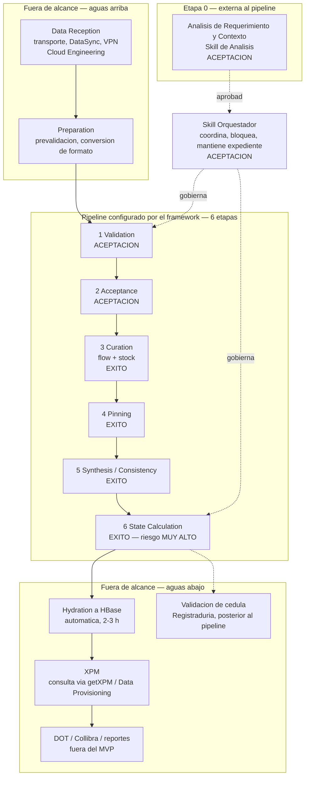

# 03 — Pipeline EDF

| Campo | Valor |
|---|---|
| Versión | 1.0.0 |
| Fecha | 2026-09-23 |
| Estado | PROPUESTO (pasa a APROBADO con firma humana) |
| Precedencia | Subordinado a `01-restricciones-principios.md`; nombres según `02-lexico-edf.md` |
| Inclusión | **Manual.** Documento extenso: se carga cuando se trabaja sobre el flujo, no en cada turno |
| Fuentes | Las 6 fuentes vinculantes (abreviaturas en `02` §Pie) |
| Aprobador | PENDIENTE-MANUAL |

## 1. Objetivo y alcance

Una sola representación autorizada del flujo, con la frontera del framework marcada de forma inequívoca.

**Cubre:** etapas, dependencias, DAGs, avance por S3, responsables, artefactos, y la relación entre los sub-grupos de trabajo.
**No cubre:** el contrato detallado de entrada/salida de cada costura, que vive en `07-contratos-frontera.md`.

## 2. Frontera de alcance `[C]`

El framework configura **6 etapas**, más la etapa 0 de análisis que es **externa al pipeline y al flujo de ingesta**, más el Orquestador. (decisión H-4, 2026-09-23)

**Data Reception y Preparation quedan fuera del pipeline del framework y fuera de los criterios de aceptación.** (decisión H-3, 2026-09-23) `[C]`

Esto resuelve la contradicción histórica entre el alcance global —que las comprometía— y la evidencia de las sesiones, que las declaraba fuera. La consecuencia contractual es que el compromiso de aceptación de F3 cubre **Validation y Acceptance**, no la recepción ni el transporte del archivo.



El Orquestador **coordina el trabajo del desarrollador alrededor del pipeline; no lo ejecuta ni lo reemplaza.** `[C]`

## 3. Etapas del pipeline

Formato de salida por ambiente, común a las etapas donde consta: `text` en QA/STG, `avro` en Producción. `[C]`

| # | Etapa | Entrada | Salida | Artefactos que genera el skill | Estado |
|---|---|---|---|---|---|
| 0 | Análisis de Requerimiento | HU + spec de Confluence (obligatorias, ver la nota bajo la tabla); muestra y layout (opcionales) | `contexto-ingesta.md`, `mapeo-campos.md`, dependencias, plan de ruta | Solo `.md`. **Nunca código** | `[C]` |
| 1 | Validation | Archivo preparado | Registros validados + reporte de inconsistencias + Quality Score | Configuración de `SparkValidationApp`, catálogos de homologación y DIVIPOLA, reglas por campo, cálculo de Quality Score, log de inconsistencias | `[C]` |
| 2 | Acceptance | Registros validados | Aceptados / rechazados + FQS + notificaciones | Bloque `acceptance.<ingesta>` en HOCON, regla `recordAcceptance`, cálculo de FQS, reportes | `[C]` |
| 3 | Curation | Eventos aceptados | Eventos curados (`flow` y `stock`) | `<Ingesta>CurationProcessor`, `<Ingesta>CuratedEvent`, transformaciones (estandarización, homologación, epoch, enriquecimiento), manejo de RT/EP, registro en el domain dictionary | `[C]` |
| 4 | Pinning | Eventos curados | Eventos con PIN asignado + fase HC | `identifying-attributes-<ingesta>.json` / ITT, configuración de `identitySufficiency`, reglas especiales, matching `NearNeighborKeys`, validación contra BDIIREGI | `[C]` |
| 5 | Synthesis / Consistency | Eventos con PIN | Eventos sintetizados + resultados de consistencia | Diccionario de dominio, `colombia-consistency-checks-dictionary.json`, asignación de Field Handler (LFP/LAP/EUC) por campo | `[C]` |
| 6 | State Calculation | Eventos sintetizados | Estado final agregado al XPM + certificación de 4 dimensiones | Configuración de agregación por sección (`statecalcAlpha-js-foundation-stage.json`, flag tipo `isSisben`), y detección de si se requiere lógica adicional en el enricher o si es passthrough | `[C]` |

Compuerta de entrada de la etapa 0: La HU y la spec de Confluence son obligatorias. Si falta alguna, el análisis no arranca: se dice cuál falta y se detiene. `[C]`

### 3.1 Puntos de entrada canónicos `[C]`

| Etapa | Punto de entrada | Contrato de extensión |
|---|---|---|
| Validation | `SparkValidationApp` | `ValidationProcessor` |
| Acceptance | `AcceptanceApp` | DSL `fileActions` / `recordAcceptance` |
| Curation | `CurationApp` → `SparkCuratorInitializer` | `CurationProcessor` (`readAcceptedEvent`, `curateEvent`, `enrichEventWithPayload`) |
| Pinning | `PinningApp` | `IdentityMatcher` / `IdentityImpl`, `ColombiaIdentityMatcher`, `ColombiaClusterSplitter` |
| Synthesis | `SynthesisApp` | Field Handlers por campo |
| State Calculation | `StateCalcColombiaApp` | `ColombiaFoundationStateEnricher` |

Todos los puntos de entrada son de 6-10 líneas: crean el inicializador e invocan `run`. El comportamiento vive en configuración y en el processor, nunca en el `main`. `[C]`

## 4. Dependencias entre etapas

Orden estrictamente secuencial. Cada etapa consume el marcador de completitud de la anterior. `[C]`

```
Validation -> Acceptance -> Curation (flow | stock) -> Pinning (+HC) -> Synthesis/Consistency -> State Calculation
```

| Dependencia | Naturaleza | Estado |
|---|---|---|
| Preparation → Validation | Externa al framework. El delimitador que Validation espera debe coincidir con lo que Preparation entrega | `[C]` frontera / `[PM]` verificación |
| Validation → Acceptance | Registros validados con su Quality Score | `[C]` |
| Acceptance → Curation | Eventos aceptados; el rechazo es a nivel de **archivo completo** | `[C]` |
| Curation → Pinning | Eventos curados. Contrato documentado en `11-contrato-curation-pinning.md` (formato y normalización confirmados; ruta de entrada y clave `nationalId` pendientes) | `[A:OQ-IL-3]` parcial |
| Pinning → Synthesis | Eventos con PIN; Synthesis hidrata desde HBase | `[C]` |
| Synthesis → State Calculation | Eventos sintetizados y reconciliados | `[C]` |
| State Calculation → Hydration | Automática, 2-3 h, fuera del pipeline | `[C]` |
| Curation ↔ Pinning (borrado) | El manejo de EP en Curation se diseñó agnóstico a `inferDelete` de Pinning. Si ambas infieren borrado, puede haber colisión | `[A:PT-12]` |

**Modos de ejecución** que afectan la dependencia: Curation corre en `flow` (incremental) o `stock` (histórico); Pinning corre estático o dinámico según `reusePIN`, que es `false` para una ingesta nueva. `[C]`

## 5. Orquestación real: los 4 DAGs

La orquestación corre en Airflow/MWAA con **4 DAGs ya implementados que el framework no modifica** (E10). Ejecución secuencial con verificación manual entre DAGs. `[C]`

| DAG | Etapas que dispara | Horario | Estado |
|---|---|---|---|
| Daily Validation | Validation | ~08:00 | `[C]` |
| Acceptance + Curation Flow | Acceptance, Curation (`flow`) | ~10:00 | `[C]` |
| Collection Stock | Curation (`stock`) | Sin horario documentado | `[PM]` |
| State Generation (`<env>_State_Generation_Week_Days`) | Pinning, Synthesis/Consistency, State Calculation | ~14:00 | `[C]` |

Regla dura: **un DAG de Airflow y el Skill Orquestador son cosas distintas.** El DAG ejecuta el pipeline en AWS; el Orquestador coordina el trabajo del desarrollador y no dispara nada (`01` §2, Z3). `[C]`

## 6. Cómo se materializa el avance

El estado entre etapas **no vive en una base de datos: se materializa como movimiento de archivos en S3**, con marcadores. `[C]`

Raíz por ambiente: `s3://<env>-<cuenta>-emr-coslabureau-data/<env>_sla_co_ebp_1/` — cuentas dev 167753196070 · qa 408515789114 · stg 133974715783 · pro 612452938387. `[C]`

```
validated/                         <- salida de Validation
accepted/                          <- salida de Acceptance (permanece)
rejects/                           <- rechazados de Acceptance
curated/  + marcador ready-curate  <- salida de Curation
pinning/pinned/                    <- salida de Pinning
pinning/pinned/{id}-pin-hc/        <- fase HC de Pinning
consistency/synthesized/           <- salida de Synthesis
statecalc/calculated/{id}          <- salida de State Calculation
statecalc/additionalFoundation/    <- configuracion adicional de foundation
reports/<etapa>/                   <- reportes por etapa
JobLogs/<fecha>/                   <- logs de ejecucion
<generacion por epoca EPOC>/       <- carpeta de generacion: PIN, Consistency, State Calculation
```

`generationId` y la época EPOC son **dinámicos**: prohibido hardcodear rutas que los contengan (`01` P4). `[C]`

## 7. Responsables

| Rol | Quién | Alcance | Estado |
|---|---|---|---|
| Operador del framework | Ingeniero de datos de Experian | Usa los skills, aprueba o rechaza cada artefacto | `[C]` |
| Dueños del patrón | Equipo Ingesta 3 — Julio Morales, Jose Lozano, Andrés Pérez | Revisan y aprueban el patrón generado | `[C]` |
| Aprobador formal del patrón | Sin designar, requerido antes del 2026-11-19 | Línea base del criterio de garantía | `[A:OQ-06]` |
| Responsable nominal por etapa | Sin designar | — | `[PM]` |
| Infraestructura y despliegue | Cloud Engineering / Experian (~25 áreas) | Data Reception, IAM, redes, ambientes | `[C]` |
| Consumidor aguas abajo | Data Provisioning | Consume el XPM | `[C]` |

## 8. Relación entre los sub-grupos de trabajo

Los tres sub-grupos son **organización interna del equipo de construcción del framework**, no capas del pipeline (`05` §4.2). Su relación con las etapas es esta:

| Sub-grupo | Etapas | Qué produce | Compromiso agregado |
|---|---|---|---|
| **Requerimientos y Orquestador** | 0 + Orquestación | Contexto aprobado, mapeo de campos, expediente, bitácora. **Solo `.md`** | Aceptación (F1, F2) |
| **Ingesta y Limpieza** | 1, 2, 3 | Código Scala y configuración HOCON de Validation, Acceptance, Curation | Aceptación en 1 y 2; **éxito** en 3 |
| **Transformes** | 4, 5, 6 | Código Scala y configuración HOCON/JSON de Pinning, Synthesis, State Calculation | Éxito |

Secuencia de gobierno entre sub-grupos: el análisis de la etapa 0 se aprueba **antes** de que el Orquestador habilite la etapa 1; a partir de ahí se exige aprobación entre cada par de etapas. `[C]`

**Sobre "transformación":** el término `Transformador` está excluido del léxico (`02` §9). Cuando la documentación previa habla de "transformación", se refiere al sub-grupo **Transformes** (etapas 4-6) o a las transformaciones de campo de Curation. Ambos sentidos deben escribirse explícitos.

## 9. Huecos conocidos del pipeline

Declarados como pendientes, **no bloqueantes** para este steering (decisión del 2026-09-23).

| # | Hueco | Efecto | Estado |
|---|---|---|---|
| 1 | Contrato exacto de entrada que Pinning espera de Curation | La costura 3→4 no se puede certificar | `[A:OQ-IL-3]` |
| 2 | Horario del DAG Collection Stock | El expediente no puede predecir la ventana de `stock` | `[PM]` |
| 3 | Responsable nominal por etapa | Sin dueño de escalamiento por etapa | `[PM]` |
| 4 | Rutas S3 completas por etapa (raíz y carpetas constan; el patrón completo no) | Riesgo de ruta mal construida en la configuración generada | `[PM]` |
| 5 | Etapa 7 ausente en la numeración 0-9 de Experian | Posible etapa no mapeada | `[A:OQ-11]` |
| 6 | Qué etapas corren sobre InnerSource en Colombia, rama y versión | La especificación podría describir un motor que no es el de producción | `[A:PT-11]` |
| 7 | Pruebas de no afectación: quién relanza las ingestas certificadas y con qué datos | El deber de no regresión no es ejecutable | `[A:PT-06]` |
| 8 | Tópicos Kafka adicionales para SISBEN | Solo relevante si aparece High Frequency, hoy fuera de alcance | `[A:CQ-003]` |
| 9 | Canal real de envío al DNP | Obligación contractual con placeholder | `[A:CQ-005]` |
| 10 | Configuración SISBEN heredada que podría colisionar en Pinning | Riesgo de conflicto al certificar | `[A:OQ-TR-3b]` |
| 11 | ¿SISBEN pasa por Synthesis? `curation-pinning-sisben.md` §8 cita un diseño aprobado "Use EDF, but no synthesis for this. Periodicity will be Unique"; el Levantamiento §7.4 agrega `sisben` a `eventTypeList`. Ambas son evidencia de nivel 3 (`04` §7). Si no pasa, falta un estado explícito con firma del PO; `omitida` **no** cuenta como aprobada | Mientras siga abierta, `state_calculation` no se habilita (depende de `synthesis` aprobada) | `[A:OQ-TR-4]` — **bloqueante** para la etapa 6 de una ingesta cuya spec no lo declare. **SISBEN: resuelto, sí pasa por Synthesis** (`spec-sisben.md` §12; `00` §6) |
| 12 | Nombres de los campos curados no identitarios que espera StateCalc / XPM. Tres juegos en conflicto: inglés (`curation-pinning-sisben.md` §4; la ingesta certificada MURIC también publica en inglés, `curation-muric.md` §4), español propuesto (`contratos_frontera.md` 2026-09-29) y español del Levantamiento §8.3. Los nombres del domain dictionary son inmutables una vez publicados | Solo `standardizedIdType` y `standardizedIdNumber` tienen cadena completa hasta XPM; los 23 restantes no se generan | `[A:OQ-TR-5]` — decide el equipo Synthesis/Pinning/StateCalc |
| 13 | Cómo hace match SISBEN en `ColombiaIdentityMatcher`. La regla 1 (tipo + número basta) exige una bandera de fuente en `true`; SISBEN no tiene una propia. Ver `11` §6 #6 | Sin bandera, SISBEN cae en la regla 2 (tipo + número + nombre) | `[A:OQ-TR-6]` — **bloqueante** para Pinning |

## Pendientes de este documento

Los diez huecos de §9, más:

| # | Pendiente | Estado |
|---|---|---|
| 11 | Verificación de que el delimitador que Validation espera coincide con lo que Preparation entrega | `[PM]` |
| 12 | Comunicación formal de las decisiones H-3, H-4 y H-5 al Product Definition global y a los otros flujos | `[PM]` |

## Pie de trazabilidad

- Frontera del pipeline y las 6 etapas: decisiones H-3 y H-4 (2026-09-23); `12/tech` §Arquitectura; `12/vision` §Frontera real del pipeline.
- Etapas 1-3 y sus artefactos: `11/vision` §Feature Areas; `11/tech` §Project Structure.
- Etapas 4-6, rutas S3 y puntos de entrada: `13/tech` §Cloud Services, §Example Code; `13/vision` §Feature Areas; HU-SISBEN-006/007/008 (citadas vía 13/*).
- DAGs y movimiento en S3: `12/tech` §Estado/expediente.
- Compromisos de aceptación y éxito: `PD/vision` §MVP Scope; decisiones H-3 y H-11.
- Última verificación de referencias: 2026-09-23.
