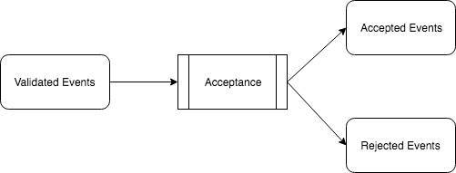
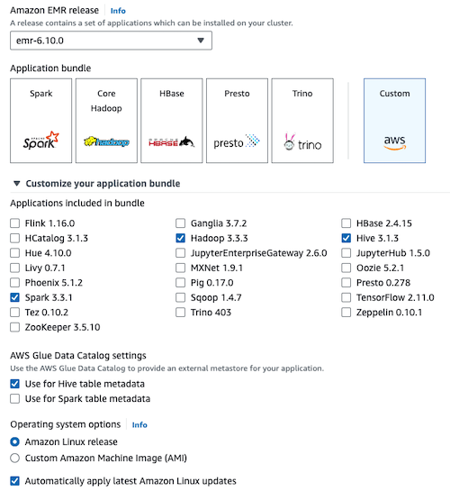

# InnerSource Acceptance <a name="pagetop"></a>


## Introduction <a name="intro"></a>
The goal of the acceptance stage is to accept or reject events and in turn accept and reject whole files of validated events.



The acceptance functionality for Oxygen is completely configuration driven. The acceptance configuration works at record level and at file level.  It defines a "filePattern" element which is a regular expression to match the possible names of files entering the pipeline for acceptance. Once the filename matches the pattern, the config element "fileAcceptance" is used to first define a rejection criteria and then a acceptance criteria. The "reject" criteria is evaluated first. If the rejection criteria evaluates to true, then the file is rejected straightaway and pushed to the rejected bin. If the rejection criteria evaluates to false, the accept criteria is evaluated.

If the accept criteria evaluates to "false", the file will remain in the validated bin. The next time the acceptance is run, the file will once again be evaluated for acceptance. The reason for this two step process, is to enable an external system / BOS system to be able to intervene in the acceptance process. This feature of the external system intervention is enabled via the externalAction function / macro. Invoking this macro allows the framework to check the value of certain database fields (in this case below we check the value of the "osapproval" field in the db) and make a decision whether they have been set by an external system.

In order for any external system to make this decision, it will use operational metrics information reported by the pipeline and then invoke a REST API provided by Oxygen to actually set this field value. Once this value has been set, in the next batch run of acceptance, this expression would evaluate to true and Oxygen would then accept the file and move it to the accepted bin.

One point to note is that the acceptance and rejection criteria are boolean expressions, which can be a combination of several other boolean expressions. This allows for powerful capabilities since we can combine an automatic expression from Oxygen along with a external action.

Example:

```
################# Oxygen IS dev profile ###################
# Please use the env.conf to set oxygen.application.paths.userHome.
# env.conf is completely yours. Use it as you will!!
################# Oxygen IS dev profile ###################

oxygen {
  stage {
    acceptance {
      configs = [
        {
          # For Credit Master File
          filePattern = ".*E-.*\\..+\\.T"
          fileActions {
            reject = false
            #accept = "(externalAction(\"opsApproval\") == \"rejected\" )"           
            # accept="headerErrorIn(\"CREDVH00001\") and footerErrorNotIn(\"CREDVF00001\")"
          }
          recordAcceptance = "(qs1 > 60.0)"
        }
      ]
    }
  }
}
```


[Return to Top](#pagetop)


---

## Get Started <a name="getstarted"></a>

---
### BUILD <a name="build"></a>
#### Prerequisites <a name="buildprerequisites"></a>
- [Maven](https://maven.apache.org/install.html) (brew install maven for macOS)
- [Git](https://git-scm.com/book/en/v2/Getting-Started-Installing-Git) (brew install git for macOS)
- [JDK 11](https://docs.azul.com/core/zulu-openjdk/install/macos) (install Zulu OpenJDK 11 in Self Service)
- [SSL certificates](https://pages.experian.com/display/DEVSECOPS/How+to+install+Bitbucket%27s+SSL+certificates)

#### Build Acceptance <a name="buildAcceptance"></a>
1\. Select a local working directory
> cd {/your/path}

2\. Clone the Acceptance repository
> git clone https://code.experian.local/projects/EEO/repos/oxygen-acceptance/browse
>
> cd oxygen-acceptance

3\. Build Acceptance
> ./build_acceptance.sh
>
>or
>
> mvn -DskipTests clean package

Upon completion of the build, a JAR file is created at
> {/your/path}/oxygen-acceptance/target/oxygen-acceptance-innersource-1.0.jar

[Return to Top](#pagetop)

---

### RUN <a name="run"></a>
#### Prerequisites <a name="runprerequisites"></a>
- [JDK 11](https://docs.azul.com/core/zulu-openjdk/install/macos) (install Zulu OpenJDK 11 in Self Service)
- [Scala](https://www.scala-lang.org/download/) 2.12.15
- [Spark](https://spark.apache.org/downloads.html) 3.3.1
- [Hadoop](https://hadoop.apache.org/releases.html) 3


#### Use docker <a name="docker"></a>
It is recommended to use the docker that has all the required setups. The docker container has pre-installed
- JDK 11
- Scala 2.12.15
- Spark 3.3.1
- Hadoop 3
- Python 3.11 (along with JupyterLab for analysis)

Build docker (only necessary upon initial use)

Download and load docker image “[innersource-oxygen-docker.tar](https://code.experian.local/projects/EEO/repos/innersource-oxygen-docker/raw/innersource-oxygen-docker.tar?at=refs%2Fheads%2Fmain)”

> docker load -i {path/to/}innersource-oxygen-docker.tar

Alternatively, build with Dockerfile (without VPN)

> cd {/your/path}/oxygen-acceptance
>
> ./build_docker.sh

Run docker
> ./run_docker.sh

#### Run Acceptance locally while running Docker<a name="runAcceptance"></a>
Example files in "example/validatedfiles"

Run Acceptance with sample inputs and configurations
> spark-submit --master local --class com.experian.edf.oxygen.acceptance.app.AcceptanceApp target/oxygen-acceptance-innersource-1.0-jar-with-dependencies.jar env.conf acceptance-application.conf

The example run uses these two configuration files
> src/main/resources/env.conf \
> src/main/resources/acceptance-application.conf

In the configurations (acceptance-application.conf), we define:

- Input path:
> *validationDir = "/data/example/test-workspace/validation/validated"* \
> In the configuration file, add the path to "validation". The program will automatically search for the validated file within this folder (Example: validationDir = "example/test-workspace/validation"), add the files to be processed in the validated folder 

> This path will search inside the validation folder a *validated* folder.  

- Output path:
> *acceptedDir = "/data/example/test-workspace/accepted"* \
> *rejectedDir = "/data/example/test-workspace/rejected"*

---

#### Acceptance example run in Jupyter notebook <a name="jupyter"></a>
A Jupyter notebook, named [*example.ipynb*](example.ipynb), can be utilized to run Acceptance locally and display the key information from input, intermediary results, and output. This aids in acquiring a better understanding of the process.

Within the Docker, initiate JupyterLab
> cd /data
>
> ./run_jupyterlab.sh

Access the Jupyter notebook in your browser
> https://localhost:8888/

Within JupyterLab, open the notebook
> example.ipynb

[Return to Top](#pagetop)

---

### RUN ON AWS <a name="aws"></a>
1\. Post-build, upload the JAR to S3.

- From JAR location:
> {/your/path}/oxygen-pinning/target/oxygen-acceptance-innersource-1.0-jar-with-dependencies.jar

- To example S3 location:
> s3://oxygen-innersource/demo-acceptance/lib/

2\. Upload the configuration files to S3.

- From configuration files location:
> {/your/path}/oxygen-acceptance/aws/conf/*

- To example S3 location:
> s3://oxygen-innersource/demo-acceptance/conf/

3\. Upload input to S3.

- From input location:
> {/your/path}/oxygen-Acceptance/example/test-workspace/validated

- To example S3 location:
> s3://oxygen-innersource/demo-acceptance/input/

4\. Start an EMR cluster with these applications \


Connect to the primary node of the EMR cluster using the given IP address, for example
> ssh -i ~/xxxxxxxx.pem hadoop@10.229.78.184

5\. Run Acceptance on AWS

> spark-submit --verbose \\  
> --master yarn \\  
> --deploy-mode cluster \\  
> --executor-cores 2 \\  
> --executor-memory 4G \\  
> --num-executors 2 \\  
> --driver-memory 4G \\  
> --conf "spark.yarn.submit.waitAppCompletion=true" \\  
> --files $(echo s3://oxygen-innersource-test/demo-acceptance/conf//\*.\* | tr ' ' ',') \\  
> --jars "s3://oxygen-innersource-test/demo-acceptance/lib/\*.jar" \\  
> --conf "spark.dynamicAllocation.enabled=false" \\  
> --conf "spark.driver.extraClassPath=/usr/lib/hadoop-lzo/lib/\*:/usr/lib/hadoop/hadoop-aws.jar:/usr/share/aws/aws-java-> sdk/\*:/usr/share/aws/emr/emrfs/conf:/usr/share/aws/emr/emrfs/lib/\*:/usr/share/aws/emr/emrfs/auxlib/\*:/usr/share/aws/emr/goodies/lib/emr-spark-goodies.jar:/usr/share/aws/emr/security/conf:/usr/share/aws/emr/security/lib/\*:/usr/share/aws/hmclient/lib/aws-glue-datacatalog-spark-client.jar:/usr/share/java/Hive-JSON-Serde/hive-openx-serde.jar:/usr/share/aws/sagemaker-spark-sdk/lib/sagemaker-spark-sdk.jar:/usr/share/aws/emr/s3select/lib/emr-s3-select-spark-connector.jar" \\  
> --conf "spark.executor.extraClassPath=/usr/lib/hadoop-lzo/lib/\*:/usr/lib/hadoop/hadoop-aws.jar:/usr/share/aws/aws-java-sdk/\*:/usr/share/aws/emr/emrfs/conf:/usr/share/aws/emr/emrfs/lib/\*:/usr/share/aws/emr/emrfs/auxlib/\*:/usr/share/aws/emr/goodies/lib/emr-spark-goodies.jar:/usr/share/aws/emr/security/conf:/usr/share/aws/emr/security/lib/\*:/usr/share/aws/hmclient/lib/aws-glue-datacatalog-spark-client.jar:/usr/share/java/Hive-JSON-Serde/hive-openx-serde.jar:/usr/share/aws/sagemaker-spark-sdk/lib/sagemaker-spark-sdk.jar:/usr/share/aws/emr/s3select/lib/emr-s3-select-spark-connector.jar" \\  
> --conf "spark.executor.extraJavaOptions=-XX:+UseG1GC" \\  
> --conf "spark.hadoop.mapreduce.fileoutputcommitter.algorithm.version=2" \\  
> --conf "spark.driver.extraJavaOptions=-Dfile.encoding=utf-8" \\  
> --conf "spark.executor.extraJavaOptions=-Dfile.encoding=utf-8" \\  
> --conf "spark.executor.extraJavaOptions=-Dlog4j.debug=true" \\  
> --conf "spark.executor.extraJavaOptions=-Dlog4j.configuration=log4j.properties" \\  
> --class com.experian.edf.oxygen.acceptance.app.AcceptanceApp \\  
> s3://oxygen-innersource-test/demo-acceptance/lib/oxygen-acceptance-innersource-1.0-jar-with-dependencies.jar \\  
> env.conf \\  
> acceptance-application.conf

6\. Inspect the output directory (as specified in the configuration) on S3
> s3://oxygen-innersource/demo_acceptance/output/accepted

7\. Terminate the EMR cluster

[Return to Top](#pagetop)

---
---

## Advanced Usage <a name="advanced"></a>
Please refer to the following link for detailed information on advanced usage: [advanced.md](advanced.md).

---
---

## Migration from the Oxygen Pipeline <a name="migrate"></a>
Please refer to the following steps to transition from the Oxygen Pipeline Acceptance stage to InnerSource Acceptance: [migrate.md](migrate.md).

---
---


## Metadata <a name="discoverability"></a>
This data below is included to aid the InnerSource Discovery Hub in integrating this content into the Innersource consciousness.

```discoveryhub
app_id: OF-3819
region: Global
bu: EITS
contacts: 
  - roshan.yadav@experian.com
  - juanesteban.quesada@experian.com 

jira: https://agile.experian.com/browse/OF-3819
tags: acceptance, oxygen acceptance, Scala, Java, data ingestion
```

---
---

## Contribution <a name="contribution"></a>

Pull requests are welcome. For significant changes, we kindly request you to open an issue first to discuss your proposed alterations.

Please ensure to update tests as necessary.

[Oxygen Standards for Coding](https://pages.experian.com/display/ODC/Oxygen+Standards+for+Coding)

---
---

## License <a name="license"></a>

[Experian](https://www.experian.com/)

[Return to Top](#pagetop)
