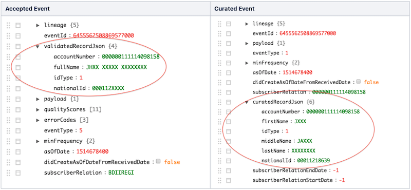
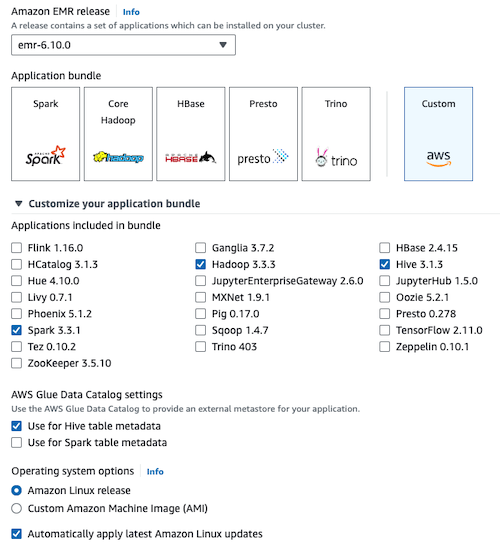

# InnerSource Curation <a name="pagetop"></a>

1. [Introduction](#intro)
   - [Input](#inputevents)
   - [User-defined Curation Event, Processor and Lookup](#extensions)
   - [Configuration](#conf)
   - [Summary](#summary)
2. [Get Started](#getstarted)
   - [BUILD](#build)
       - [Prerequisites](#buildprerequisites)
       - [Build Curation](#buildcuration)
   - [RUN](#run)
       - [Prerequisites](#runprerequisites)
       - [Use docker](#docker)
       - [Run Curation locally](#runcuration)
       - [Curation example run in Jupyter notebook](#jupyter)
   - [RUN ON AWS](#aws)
3. [Advanced Usage](#advanced)
4. [Migration from the Oxygen Pipeline](#migrate)
5. [Discoverability Info](#discoverability)
6. [Contribution](#contribution)
7. [License](#license)

---
---

## Introduction <a name="intro"></a>
Curation is the process of standardizing events. During this stage, accepted events are transformed, cleaned, enriched by user-defined processors, and converted into curated events.



Here is a simple example of an accepted event being curated: An accepted event from the raw file may contain only the full name of an individual in the "fullName" field. After being processed by a user-defined Curation Processor, the name in the curated event is split into "firstName", "middleName", and "lastName", all of which are required for subsequent downstream processing. The curated output now includes events with 6 fields (idType, nationalId, accountNumber, firstName, middleName, and lastName), rather than the 4 found in the accepted event.


For complete details, please refer to the [Oxygen Curation Documentation](https://pages.experian.com/display/ODC/Building+your+pipeline+-+Curation) and [Tutorial](https://pages.experian.com/display/ODC/Oxygen+tutorials%3A++Hands-on+Curation+stage).

### Input <a name="inputevents"></a>
The inputs for the curation process are events that have been validated and accepted. Input events usually arrive in batches as folders with different names.

Example:
1. A folder "*E-230001.20161113.T.7042204574991252479*" containing a batch of accepted events ([link](./example/accepted-input/E-230001.20161113.T.7042204574991252479))
2. Sample accepted events ([link](./example/accepted-input/E-230001.20161113.T.7042204574991252479/part-00000-1dfb3d57-28f8-4d14-9fde-88a451a6bb3a-c000.json))

### User-defined Curation Event, Processor and Lookup <a name="extensions"></a>
The extended CuratedEvent class, such as [CreditCuratedEvent](src/main/scala/com/experian/edf/oxygen/curation/extension/event/CreditCuratedEvent.scala), defines the format of the curated events in the output. 

Similarly, the extended CurationProcessor class, like [CreditCurationProcessorJson](src/main/scala/com/experian/edf/oxygen/curation/extension/processor/CreditCurationProcessorJson.scala), determines how the accepted events are standardized.

In addition, curation fields may utilize reference files as lookup tables (e.g., an official national ID list). Here are some [sample lookup files](example/lookup).

### Configuration <a name="conf"></a>
In the configuration, specific processors are assigned to specific input folders (batches) using the regular expression filePattern. For instance, the processor "*com.experian.edf.oxygen.curation.extension.processor.CreditCurationProcessorJson*" will process the accepted events in folders matching the filePattern ".\*E-.\*\\\\..+\\\\.T". The input folder "*E-230001.20161113.T.7042204574991252479*" will be matched in this case.

```
oxygen {
  stage {
    curation {
      configs = [
        {
          filePattern = ".*E-.*\\..+\\.T"
          processor = "com.experian.edf.oxygen.curation.extension.processor.CreditCurationProcessorJson"
        },
        {
          filePattern = ".*X-.*\\..+\\.T"
          processor = "com.experian.edf.oxygen.curation.extension.processor.CreditCurationProcessorJson"
        }
      ]
    }
  }
}
```
Here is the full [sample curation configuration file](src/main/resources/curation-application.conf).

The [CurationApp](src/main/scala/com/experian/edf/oxygen/curation/app/CurationApp.scala), in its arguments, links the curation configuration file with a lookup configuration file ([oxygen-lookup.conf](src/main/resources/local/oxygen-lookup-local.conf)) to perform the reference lookups.

### Summary <a name="summary"></a>

Through curation, the raw information in the accepted events is transformed into a standard format. Users can define various processors to transform, clean, and enrich the fields, and assign them to different input batches by matching folder name patterns. Users may also utilize reference lookup tables to maintain consistency of reference fields. Ultimately, raw events from diverse sources become well-structured curated events ([sample output](example/curated-output/stock)), prepared for further downstream processing.


[Return to Top](#pagetop)

---
---

## Get Started <a name="getstarted"></a>

---

### BUILD <a name="build"></a>
#### Prerequisites <a name="buildprerequisites"></a>
- [Maven](https://maven.apache.org/install.html) (brew install maven for macOS)
- [Git](https://git-scm.com/book/en/v2/Getting-Started-Installing-Git) (brew install git for macOS)
- [JDK 11](https://docs.azul.com/core/zulu-openjdk/install/macos) (install Zulu OpenJDK 11 in Self Service)
- [SSL certificates](https://pages.experian.com/display/DEVSECOPS/How+to+install+Bitbucket%27s+SSL+certificates)


#### Build Curation <a name="buildcuration"></a>
1\. Select a local working directory
> cd {/your/path}

2\. Clone the Curation repository
> git clone https://code.experian.local/scm/eeo/oxygen-curation.git
> 
> cd oxygen-curation

3\. Build Curation
> ./build_curation.sh
>
>or
>
> mvn -DskipTests clean package

Upon completion of the build, a JAR file is created at 
> {/your/path}/oxygen-curation/target/oxygen-curation-innersource-1.0-jar-with-dependencies.jar

[Return to Top](#pagetop)

---

### RUN <a name="run"></a>
#### Prerequisites <a name="runprerequisites"></a>
- [JDK 11](https://docs.azul.com/core/zulu-openjdk/install/macos) (install Zulu OpenJDK 11 in Self Service)
- [Scala](https://www.scala-lang.org/download/) 2.12.15
- [Spark](https://spark.apache.org/downloads.html) 3.3.1
- [Hadoop](https://hadoop.apache.org/releases.html) 3


#### Use docker <a name="docker"></a>
It is recommended to use the docker that has all the required setups. The docker container has pre-installed
- JDK 11
- Scala 2.12.15
- Spark 3.3.1
- Hadoop 3
- Python 3.11 (along with JupyterLab for analysis)

Build docker (only necessary upon initial use)

Download and load docker image “[innersource-oxygen-docker.tar](https://code.experian.local/projects/EEO/repos/innersource-oxygen-docker/raw/innersource-oxygen-docker.tar?at=refs%2Fheads%2Fmain)”

> docker load -i {path/to/}innersource-oxygen-docker.tar

Alternatively, build with Dockerfile (without VPN)

> cd {/your/path}/oxygen-curation
> 
> ./build_docker.sh

Run docker
> ./run_docker.sh


#### Run Curation locally <a name="runcuration"></a>
Run Curation with sample inputs and configurations
> spark-submit --master local --class com.experian.edf.oxygen.curation.app.CurationApp target/oxygen-curation-innersource-1.0-jar-with-dependencies.jar env.conf curation-application.conf oxygen-lookup.conf

Run Curation with defined usage of driver and executors
> spark-submit --master local[2] --driver-memory 2g --executor-memory 2g --class com.experian.edf.oxygen.curation.app.CurationApp target/oxygen-curation-innersource-1.0-jar-with-dependencies.jar env.conf curation-application.conf oxygen-lookup.conf

The example run uses these 3 configuration files
> src/main/resources/env.conf
>
> src/main/resources/curation-application.conf
>
> src/main/resources/oxygen-lookup.conf

In the configurations, we define
- Input path:
> *oxygen.stage.acceptance.paths.acceptedDir = "/data/example/accepted-input"*

- Output path:
> *oxygen.stage.curation.paths.curatedDir = "/data/example/output-demo"*

- Lookup path:
> *oxygen.application.paths.lookupHome = "/data/example/lookup"*

- Extension processor classes for particular file patterns:
> *oxygen.stage.curation.configs[*
>   
> *{filePattern = ".*E-.*\\..+\\.T", processor = "com.experian.edf.oxygen.curation.extension.processor.CreditCurationProcessorJson"},*
> 
> *{filePattern = ".*X-.*\\..+\\.T", processor = "com.experian.edf.oxygen.curation.extension.processor.CreditCurationProcessorJson"}*
> 
> ]

#### Curation example run in Jupyter notebook <a name="jupyter"></a>
A Jupyter notebook, named [*example.ipynb*](example.ipynb), can be utilized to run Curation locally and display the key information from input, intermediary results, and output. This aids in acquiring a better understanding of the process.

Within the Docker, initiate JupyterLab
> cd /data
> 
> ./run_jupyterlab.sh

Access the Jupyter notebook in your browser
> https://localhost:8888/

Within JupyterLab, open the notebook
> example.ipynb

[Return to Top](#pagetop)

---

### RUN ON AWS <a name="aws"></a>
1\. Post-build, upload the JAR to S3.

- From JAR location:
> {/your/path}/oxygen-curation/target/oxygen-curation-innersource-1.0-jar-with-dependencies.jar

- To example S3 location:
> s3://oxygen-innersource-test/demo-curation/lib/

2\. Upload the configuration files to S3.

- From configuration files location:
> {/your/path}/oxygen-curation/aws/conf/*

- To example S3 location:
> s3://oxygen-innersource-test/demo-curation/conf/

3\. Upload input to S3.

- From input location:
> {/your/path}/oxygen-curation/example/accepted-input

- To example S3 location:
> s3://oxygen-innersource-test/demo-curation/input/

4\. Upload lookup files to S3.

- From input location:
> {/your/path}/oxygen-curation/example/lookup/*

- To example S3 location:
> s3://oxygen-innersource-test/demo-curation/lookup/

5\. Start an EMR cluster with these applications



Connect to the primary node of the EMR cluster using the given IP address, for example
> ssh -i ~/xxxxxxxx.pem hadoop@10.229.78.184

6\. Run Curation on AWS
> spark-submit --verbose \\  
> --master yarn \\  
> --deploy-mode cluster \\  
> --executor-cores 2 \\  
> --executor-memory 4G \\  
> --num-executors 2 \\  
> --driver-memory 4G \\  
> --conf "spark.yarn.submit.waitAppCompletion=true" \\  
> --files $(echo s3://oxygen-innersource-test/demo-curation/conf/\*.\* | tr ' ' ',') \\  
> --jars "s3://oxygen-innersource-test/demo-curation/lib/\*.jar" \\  
> --conf "spark.dynamicAllocation.enabled=false" \\  
> --conf "spark.driver.extraClassPath=/usr/lib/hadoop-lzo/lib/\*:/usr/lib/hadoop/hadoop-aws.jar:/usr/share/aws/aws-java-> sdk/\*:/usr/share/aws/emr/emrfs/conf:/usr/share/aws/emr/emrfs/lib/\*:/usr/share/aws/emr/emrfs/auxlib/\*:/usr/share/aws/emr/goodies/lib/emr-spark-goodies.jar:/usr/share/aws/emr/security/conf:/usr/share/aws/emr/security/lib/\*:/usr/share/aws/hmclient/lib/aws-glue-datacatalog-spark-client.jar:/usr/share/java/Hive-JSON-Serde/hive-openx-serde.jar:/usr/share/aws/sagemaker-spark-sdk/lib/sagemaker-spark-sdk.jar:/usr/share/aws/emr/s3select/lib/emr-s3-select-spark-connector.jar" \\  
> --conf "spark.executor.extraClassPath=/usr/lib/hadoop-lzo/lib/\*:/usr/lib/hadoop/hadoop-aws.jar:/usr/share/aws/aws-java-sdk/\*:/usr/share/aws/emr/emrfs/conf:/usr/share/aws/emr/emrfs/lib/\*:/usr/share/aws/emr/emrfs/auxlib/\*:/usr/share/aws/emr/goodies/lib/emr-spark-goodies.jar:/usr/share/aws/emr/security/conf:/usr/share/aws/emr/security/lib/\*:/usr/share/aws/hmclient/lib/aws-glue-datacatalog-spark-client.jar:/usr/share/java/Hive-JSON-Serde/hive-openx-serde.jar:/usr/share/aws/sagemaker-spark-sdk/lib/sagemaker-spark-sdk.jar:/usr/share/aws/emr/s3select/lib/emr-s3-select-spark-connector.jar" \\  
> --conf "spark.executor.extraJavaOptions=-XX:+UseG1GC" \\  
> --conf "spark.hadoop.mapreduce.fileoutputcommitter.algorithm.version=2" \\  
> --conf "spark.driver.extraJavaOptions=-Dfile.encoding=utf-8" \\  
> --conf "spark.executor.extraJavaOptions=-Dfile.encoding=utf-8" \\  
> --conf "spark.executor.extraJavaOptions=-Dlog4j.debug=true" \\  
> --conf "spark.executor.extraJavaOptions=-Dlog4j.configuration=log4j.properties" \\  
> --class com.experian.edf.oxygen.curation.app.CurationApp \\  
> s3://oxygen-innersource-test/demo-curation/lib/oxygen-curation-innersource-1.0-jar-with-dependencies.jar \\  
> env.conf \\  
> curation-application.conf \\  
> oxygen-lookup.conf

7\. Inspect the output directory (as specified in the configuration) on S3
> s3://oxygen-innersource-test/demo_curation/output/output-demo

8\. Terminate the EMR cluster

[Return to Top](#pagetop)

---
---

## Advanced Usage <a name="advanced"></a>
Please refer to the following link for detailed information on advanced usage: [advanced.md](advanced.md).

---
---

## Migration from the Oxygen Pipeline <a name="migrate"></a>
Please refer to the following steps to transition from the Oxygen Pipeline Curation stage to InnerSource Curation: [migrate.md](migrate.md).

---
---

## Metadata <a name="discoverability"></a>
This data below is included to aid the InnerSource Discovery Hub in integrating this content into the Innersource consciousness.

```discoveryhub
app_id: OF-3819
region: Global
bu: EITS
contacts: 
  - roshan.yadav@experian.com
  - larry.yin@experian.com 

jira: https://agile.experian.com/browse/OF-3819
tags: curation, oxygen curation, Scala, Java, data ingestion
```

---
---

## Contribution <a name="contribution"></a>

Pull requests are welcome. For significant changes, we kindly request you to open an issue first to discuss your proposed alterations.

Please ensure to update tests as necessary.

[Oxygen Standards for Coding](https://pages.experian.com/display/ODC/Oxygen+Standards+for+Coding)

---
---

## License <a name="license"></a>

[Experian](https://www.experian.com/)

[Return to Top](#pagetop)
