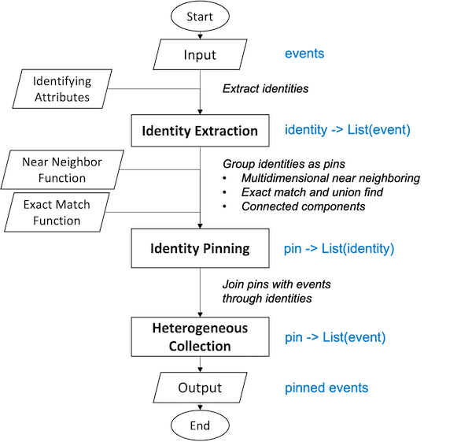
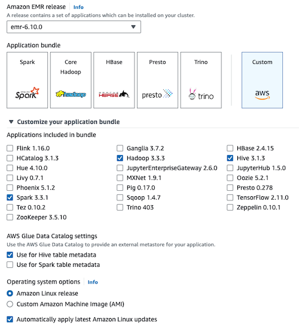

# InnerSource Pinning <a name="pagetop"></a>

1. [Introduction](#intro)
   - [Input](#inputevents)
   - [Identity Extraction](#idextraction)
   - [Identity Pinning](#idpinning)
   - [Heterogeneous Collection](#hc)
   - [Summary](#summary)
2. [Get Started](#getstarted)
   - [BUILD](#build)
       - [Prerequisites](#buildprerequisites)
       - [Build Pinning](#buildpinning)
   - [RUN](#run)
       - [Prerequisites](#runprerequisites)
       - [Use docker](#docker)
       - [Run Pinning locally](#runpinning)
       - [Pinning example run in Jupyter notebook](#jupyter)
   - [RUN ON AWS](#aws)
3. [Advanced Usage](#advanced)
4. [Migration from the Oxygen Pipeline](#migrate)
5. [Discoverability Info](#discoverability)
6. [Contribution](#contribution)
7. [License](#license)

---
---

## Introduction <a name="intro"></a>
Pinning is the process of grouping events belonging to same entity.


The Pinning process accepts curated events as input and progresses through three phases: Identity Extraction, Identity Pinning, and Heterogeneous Collection.
Initially, for each event, identity-related attributes are extracted to constitute an identity. We derive unique identities and their corresponding events to formulate an identity-event map.
Following this, identities associated with the same entities are clustered together in a process termed 'pinning.' This results in the formation of 'pins', representing individual entities along with their connected identities, leading to an establishment of a pin-identity map.
Finally, we join the pin-identity map with the identity-event map, thereby producing a complete mapping of pins and their associated events.



A Pinning job necessitates not only inputs but also user-defined identifying attributes, a Near Neighbor function, and a Pairwise (Exact) Match function to enable proper grouping of events. Detailed descriptions and examples of these files and functions are provided in subsequent sections.


### Input <a name="inputevents"></a>
The inputs for the pinning process are curated events - events that have been validated, cleaned, and transformed into a structured format. Each event is assigned a unique "eventId", with all event details stored as values in various attribute fields. ([Input example](example/curated-events-input/events_batch_0/curated_1.json)) 


### Identity Extraction <a name="idextraction"></a>
From the comprehensive information contained within an event, we extract only those attributes related to the entity's identity. These attributes, termed 'identifying attributes', form an event's identity. The identifying attributes are defined in a file as a list of field names. The path to this file is specified by  *oxygen.stage.pinning.paths.identifyingAttributesFiles* in the configuration. ([identifyingAttributesFiles example](src/main/resources/identifying-attributes-local.json))

In the example, we only extract these identity-related fields to form identities.
["firstName","middleName","firstLastName","secondLastName","nationalId","cellPhone"]

Identities extracted from the example input events are:

|   eventId | firstName   | middleName   | firstLastName   | secondLastName   |   nationalId |   cellPhone |
|----------:|:------------|:-------------|:----------------|:-----------------|-------------:|------------:|
|     -1000 | MARTHA      | MARIA        | ALBA            | PEREZ            |          010 |  2016264500 |
|      -700 | MICHAEL     | JEFFREY      | JORDAN          |                  |          007 |  5882009999 |
|      -701 | MICHAEL     | JEFFREY      | JORDAN          |                  |          007 |  5882009999 |
|      -702 | MICHAEL     | JEFFREY      | JORDAN          |                  |          007 |  5882008888 |
|      -703 | MICHAEL     |              | JORDAN          |                  |          007 |  5882007777 |
|      -704 | MICHAEL     | JEFFREY      | JORDAN          |                  |          007 |  5882007777 |
|      -705 | MIKE        | JEFFREY      | JORDAN          |                  |          007 |  5882008888 |
|      -706 | MICHAEL     | JEFFREY      | JORDAN          |                  |          900 |  5882009999 |
|      -800 | OMAR        | CARLOS       | ORTIZ           | GARCIA           |          008 |  2016264500 |
|      -801 | OMAR        | CARLOS       | ORTIZ           | GARCIA           |          008 | 98529440011 |
|      -900 | NICOLAS     | RAMON        | LOPEZ           | CONTRERAS        |          009 |  9513853222 |


### Identity Pinning <a name="idpinning"></a>

To consolidate the identities of a single entity, we implement four key steps.

1. Multidimensional Near Neighboring: To circumvent the need for full pairwise comparisons, the complete identity space is subdivided into smaller neighborhoods suitable for parallel processing. A Near Neighbor function is designed such that identities sharing the same near neighbor key constitute a neighborhood. Within these neighborhoods, pairwise exact matches are executed on a considerably smaller scale.
   In instances where connected identities span across different neighborhoods, we design near neighbors in multiple dimensions, ensuring that two connected identities coexist within a neighborhood along at least one of these dimensions.


2. Pairwise Match: The Pairwise Match function is contrived to distinguish identities related to different entities and authenticate those belonging to the same entities. This function is applied during pairwise comparisons within near neighborhoods.

3. Union Find: The Union Find algorithm identifies whether two identities are part of the same set and amalgamates disjoint sets of identities, generating identity clusters within a near neighborhood.
   
4. Connected Components: The Connected Components algorithm fuses identity clusters across dimensions and neighborhoods. 

The user designs the Near Neighbor function (.nearNeighborKeys) and the Pairwise Match function (.doesMatch) in an extended IdentityMatcher class. The name of this class is specified at *oxygen.stage.pinning.identityMatcher* in the configuration. ([Near Neighbor function and Pairwise Match function example](src/main/scala/com/experian/edf/oxygen/pinning/extension/ISIdentityMatcher.scala))

The sample Near Neighbor function subdivides identities into smaller neighborhoods along three dimensions: nationalId, name construction (comprising the first 5 characters of the firstName and the first 5 characters of the firstLastName), and cellPhone.

The sample Pairwise Match function compares two identities, returning 'true' if the identities belong to the same entity and 'false' otherwise. If the nationalIds match, the function assigns a similarity score of 0.5. If both the firstName and firstLastName match, a score of 0.3 is awarded, and identical cellPhone numbers also receive a score of 0.3. When the cumulative similarity score 0.6 or larger, the two identities are deemed to belong to the same entity.


### Heterogeneous Collection <a name="hc"></a>
The final output of pinning undergoes a Heterogeneous Collection phase, joining the pin-identity map (from the Identity Pinning step) with the identity-event map (from the Identity Extraction step). Ultimately, the results consist of a pin-event map, with pins mapped to a list of their associated events.

In the example output, an entity represented by pin 2001 is associated events with eventIds "-700", "-701", "-702", "-703", "-704", "-705", and "-706". Another entity, represented by pin 2003, is linked with events with eventIds "-800" and "-801". The remaining two entities, represented by pin 2000 and pin 2002, are each connected with a single event. ([Output example](example/pinned-output/1687825789469-pin-hc))

|   pin | eventId                                                  |
|------:|:---------------------------------------------------------|
|  2000 | ['-1000']                                                |
|  2001 | ['-700', '-701', '-702', '-703', '-704', '-705', '-706'] |
|  2002 | ['-900']                                                 |
|  2003 | ['-800', '-801']                                         |

We can validate the output of pinned events against the original input of curated events to examine how the events, represented by eventIds, are aggregated. This is particularly applicable for pin 2001 and its associated events "-700", "-701", "-702", "-703", "-704", "-705", "-706". The individual, MICHAEL JORDAN, has numerous identities, incorporating three distinct cell phone numbers, two unique national IDs, and an alternative spelling of his first name. Nevertheless, through the pinning process, these events are cohesively grouped together.

### Summary <a name="summary"></a>
Pinning is a process that associates events with the same entities. It extracts identity information from the events, reduces the comparison scope from the entire identity universe to small, multidimensional near neighbors for distributed computing, rigorously verifies identity connections within near neighbors through pairwise matching, and then merges identity connections across near neighbors. Unique pins are then assigned to connected identity clusters to represent individual entities. Ultimately, pins are assigned to the events associated with the connected identities.

For full documentation, please refer to [Oxygen Pinning tutorial.](https://pages.experian.com/display/ODC/Building+your+pipeline+-+Pinning)

[Return to Top](#pagetop)

---
---

## Get Started <a name="getstarted"></a>

---

### BUILD <a name="build"></a>
#### Prerequisites <a name="buildprerequisites"></a>
- [Maven](https://maven.apache.org/install.html) (brew install maven for macOS)
- [Git](https://git-scm.com/book/en/v2/Getting-Started-Installing-Git) (brew install git for macOS)
- [JDK 11](https://docs.azul.com/core/zulu-openjdk/install/macos) (install Zulu OpenJDK 11 in Self Service)
- [SSL certificates](https://pages.experian.com/display/DEVSECOPS/How+to+install+Bitbucket%27s+SSL+certificates)


#### Build Pinning <a name="buildpinning"></a>
1\. Select a local working directory
> cd {/your/path}

2\. Clone the Pinning repository
> git clone https://code.experian.local/scm/eeo/oxygen-pinning.git
> 
> cd oxygen-pinning

3\. Build Pinning
> ./build_pinning.sh
>
>or
>
> mvn -DskipTests clean package

Upon completion of the build, a JAR file is created at 
> {/your/path}/oxygen-pinning/target/oxygen-pinning-innersource-1.0-jar-with-dependencies.jar

[Return to Top](#pagetop)

---

### RUN <a name="run"></a>
#### Prerequisites <a name="runprerequisites"></a>
- [JDK 11](https://docs.azul.com/core/zulu-openjdk/install/macos) (install Zulu OpenJDK 11 in Self Service)
- [Scala](https://www.scala-lang.org/download/) 2.12.15
- [Spark](https://spark.apache.org/downloads.html) 3.3.1
- [Hadoop](https://hadoop.apache.org/releases.html) 3


#### Use docker <a name="docker"></a>
It is recommended to use the docker that has all the required setups. The docker container has pre-installed
- JDK 11
- Scala 2.12.15
- Spark 3.3.1
- Hadoop 3
- Python 3.11 (along with JupyterLab for analysis)

Build docker (only necessary upon initial use)

Download and load docker image “[innersource-oxygen-docker.tar](https://code.experian.local/projects/EEO/repos/innersource-oxygen-docker/raw/innersource-oxygen-docker.tar?at=refs%2Fheads%2Fmain)”

> docker load -i {path/to/}innersource-oxygen-docker.tar

Alternatively, build with Dockerfile (without VPN)

> cd {/your/path}/oxygen-pinning
> 
> ./build_docker.sh

Run docker
> ./run_docker.sh


#### Run Pinning locally <a name="runpinning"></a>
Run Pinning with sample inputs and configurations
> spark-submit --master local --class com.experian.edf.oxygen.pinning.app.PinningApp target/oxygen-pinning-innersource-1.0-jar-with-dependencies.jar env.conf pinning-application.conf

Run Pinning with defined usage of driver and executors
> spark-submit --master local[2] --driver-memory 2g --executor-memory 2g --class com.experian.edf.oxygen.pinning.app.PinningApp target/oxygen-pinning-innersource-1.0-jar-with-dependencies.jar env.conf pinning-application.conf

The example run uses these two configuration files
> src/main/resources/env.conf
>
> src/main/resources/pinning-application.conf

In the configurations, we define
- Input path:
> *oxygen.stage.curation.paths.curatedDir = "/data/example/curated-events-input"*

- Output path:
> *oxygen.stage.pinning.paths.pinnedDir = "/data/example/output-demo"*

- Identifying Attributes file path:
> *oxygen.stage.pinning.paths.identifyingAttributesFile = ["identifying-attributes.json"]*

- Extended IdentityMatcher class (including Near Neighbor function and Pairwise Match function):
> *oxygen.stage.pinning.identityMatcher = "com.experian.edf.oxygen.pinning.extension.ISIdentityMatcher"*


#### Pinning example run in Jupyter notebook <a name="jupyter"></a>
A Jupyter notebook, named [*example.ipynb*](example.ipynb), can be utilized to run Pinning locally and display the key information from input, intermediary results, and output. This aids in acquiring a better understanding of the process.

Within the Docker, initiate JupyterLab
> cd /data
> 
> ./run_jupyterlab.sh

Access the Jupyter notebook in your browser
> https://localhost:8888/

Within JupyterLab, open the notebook
> example.ipynb

[Return to Top](#pagetop)

---

### RUN ON AWS <a name="aws"></a>
1\. Post-build, upload the JAR to S3.

- From JAR location:
> {/your/path}/oxygen-pinning/target/oxygen-pinning-innersource-1.0-jar-with-dependencies.jar

- To example S3 location:
> s3://oxygen-innersource/demo-pinning/lib/

2\. Upload the configuration files to S3.

- From configuration files location:
> {/your/path}/oxygen-pinning/aws/conf/*

- To example S3 location:
> s3://oxygen-innersource/demo-pinning/conf/

3\. Upload input to S3.

- From input location:
> {/your/path}/oxygen-pinning/example/curated-events-input

- To example S3 location:
> s3://oxygen-innersource/demo-pinning/input/

4\. Start an EMR cluster with these applications



Connect to the primary node of the EMR cluster using the given IP address, for example
> ssh -i ~/xxxxxxxx.pem hadoop@10.229.78.184

5\. Run Pinning on AWS
> spark-submit --verbose \\  
> --master yarn \\  
> --deploy-mode cluster \\  
> --executor-cores 2 \\  
> --executor-memory 4G \\  
> --num-executors 2 \\  
> --driver-memory 4G \\  
> --conf "spark.yarn.submit.waitAppCompletion=true" \\  
> --files $(echo s3://oxygen-innersource/demo-pinning/conf//\*.\* | tr ' ' ',') \\  
> --jars "s3://oxygen-innersource/demo-pinning/lib/\*.jar" \\  
> --conf "spark.dynamicAllocation.enabled=false" \\  
> --conf "spark.driver.extraClassPath=/usr/lib/hadoop-lzo/lib/\*:/usr/lib/hadoop/hadoop-aws.jar:/usr/share/aws/aws-java-> sdk/\*:/usr/share/aws/emr/emrfs/conf:/usr/share/aws/emr/emrfs/lib/\*:/usr/share/aws/emr/emrfs/auxlib/\*:/usr/share/aws/emr/goodies/lib/emr-spark-goodies.jar:/usr/share/aws/emr/security/conf:/usr/share/aws/emr/security/lib/\*:/usr/share/aws/hmclient/lib/aws-glue-datacatalog-spark-client.jar:/usr/share/java/Hive-JSON-Serde/hive-openx-serde.jar:/usr/share/aws/sagemaker-spark-sdk/lib/sagemaker-spark-sdk.jar:/usr/share/aws/emr/s3select/lib/emr-s3-select-spark-connector.jar" \\  
> --conf "spark.executor.extraClassPath=/usr/lib/hadoop-lzo/lib/\*:/usr/lib/hadoop/hadoop-aws.jar:/usr/share/aws/aws-java-sdk/\*:/usr/share/aws/emr/emrfs/conf:/usr/share/aws/emr/emrfs/lib/\*:/usr/share/aws/emr/emrfs/auxlib/\*:/usr/share/aws/emr/goodies/lib/emr-spark-goodies.jar:/usr/share/aws/emr/security/conf:/usr/share/aws/emr/security/lib/\*:/usr/share/aws/hmclient/lib/aws-glue-datacatalog-spark-client.jar:/usr/share/java/Hive-JSON-Serde/hive-openx-serde.jar:/usr/share/aws/sagemaker-spark-sdk/lib/sagemaker-spark-sdk.jar:/usr/share/aws/emr/s3select/lib/emr-s3-select-spark-connector.jar" \\  
> --conf "spark.executor.extraJavaOptions=-XX:+UseG1GC" \\  
> --conf "spark.hadoop.mapreduce.fileoutputcommitter.algorithm.version=2" \\  
> --conf "spark.driver.extraJavaOptions=-Dfile.encoding=utf-8" \\  
> --conf "spark.executor.extraJavaOptions=-Dfile.encoding=utf-8" \\  
> --conf "spark.executor.extraJavaOptions=-Dlog4j.debug=true" \\  
> --conf "spark.executor.extraJavaOptions=-Dlog4j.configuration=log4j.properties" \\  
> --class com.experian.edf.oxygen.pinning.app.PinningApp \\  
> s3://oxygen-innersource/demo-pinning/lib/oxygen-pinning-innersource-1.0-jar-with-dependencies.jar \\  
> env.conf \\  
> pinning-application.conf

6\. Inspect the output directory (as specified in the configuration) on S3
> s3://oxygen-innersource/demo_pinning/output/demo-0

7\. Terminate the EMR cluster

[Return to Top](#pagetop)

---
---

## Advanced Usage <a name="advanced"></a>
Please refer to the following link for detailed information on advanced usage: [advanced.md](advanced.md).

---
---

## Migration from the Oxygen Pipeline <a name="migrate"></a>
Please refer to the following steps to transition from the Oxygen Pipeline Pinning stage to InnerSource Pinning: [migrate.md](migrate.md).

---
---

## Metadata <a name="discoverability"></a>
This data below is included to aid the InnerSource Discovery Hub in integrating this content into the Innersource consciousness.

```discoveryhub
app_id: OF-3819
region: Global
bu: EITS
contacts: 
  - roshan.yadav@experian.com
  - larry.yin@experian.com 

jira: https://agile.experian.com/browse/OF-3819
tags: pinning, oxygen pinning, identity, identity resolution, identity matching, entity resolution, Scala, Java, data ingestion
```

---
---

## Contribution <a name="contribution"></a>

Pull requests are welcome. For significant changes, we kindly request you to open an issue first to discuss your proposed alterations.

Please ensure to update tests as necessary.

[Oxygen Standards for Coding](https://pages.experian.com/display/ODC/Oxygen+Standards+for+Coding)

---
---

## License <a name="license"></a>

[Experian](https://www.experian.com/)

[Return to Top](#pagetop)
