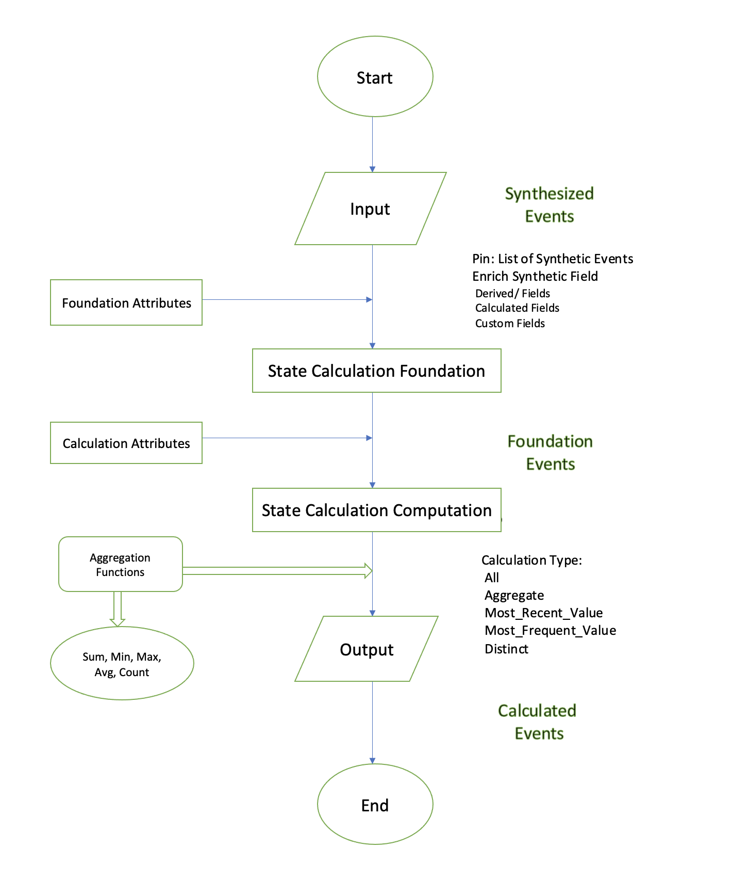

# InnerSource StateCalc <a name="pagetop"></a>

1. [Introduction](#intro)
   - [Input](#inputevents)
   - [Define statecalc foundation attributes](#statecalc-foundation-attributes)
   - [Define statecalc calculation attributes](#statecalc-calculation-attributes)
   - [Design StateCalc Calculation and Aggregation Function](#statecalc-aggregate)
   - [Review statecalc outputs](#output)
   - [Summary](#summary)
2. [Get Started](#getstarted)
   - [BUILD](#build)
       - [Prerequisites](#buildprerequisites)
       - [Build StateCalc](#buildstatecalc)
   - [RUN](#run)
       - [Prerequisites](#runprerequisites)
       - [Use docker](#docker)
       - [Run StateCalc locally](#runstatecalc)
       - [StateCalc example run in Jupyter notebook](#jupyter)
   - [RUN ON AWS](#aws)
3. [Advanced Usage](#advanced)
4. [Migration from the Oxygen Pipeline](#migrate)
5. [Discoverability Info](#discoverability)
6. [Contribution](#contribution)
7. [License](#license)

---
---

## Introduction <a name="intro"></a>
State Calculation creates a ”Behavioral Profile” for an entity after events have been synthesized and checked for consistency. 
It enriches, transforms and aggregates synthesized data. The State calculation stage provides a wide range of options to 
configure the the states using configurations and for advanced state sections/fields custom code can be written to compute data. 
State calculation is performed in 2 passes. Foundation Stage and Calculation stage. 

EXperian Profile Map (XPM) – Output of the State Calculation which provides a view served by API for viewing the State Model.


 

### Input <a name="inputevents"></a>
The inputs for the statecalc process are synthetic events - events that have been synthesize after pinning.

Each event is assigned a unique "eventId", with all event details stored as values in various attribute fields.

### Define statecalc foundation attributes <a name="statecalc-foundation-attributes"></a>
"Foundation State" is used to transform / enrich existing synthetics events. It takes synthesized events as input and produces a sparse metrics of all the fields required for the next phase(calculation).

There is one synthetic event per datasource - subscriber - subscriber relation - asOfPeriod (currently defaulting to month) coming from consistency check. This means that for a given datasource, there will be one event for Citibank (Subscriber) - Account number 11113333 (subscriber relation) for Feb 2018 (asOfPeriod)

Below, we provide an example of the statecalc-foundation attributes in use.
 
Calculated Field
For calculated types, the user is expected to provide the name of the new field to be added to each synthetic event and 
the value field is tied to a Nashhorn Javascript Engine which evaluates and populates the new field value.
Here is a snippet of code to describe this configuration. 
This configuration will produce another column called "calculatedBalance" in each synthetic event and its value will be 0.9 * balance. 
The "value" field will supports JavaScript expressions used for transformations / calculations which is demonstrated in the second 
transformation for the 'businessLineCode' field.

PS: 'field' is a variable containing all fields of current Event
{
    "domain": "creditBureau",
    "fields": [
        {
            "name": "calculatedBalance",
            "description": "Value calculated from original 'balance' field present in synthetic event. This can be any expression supported by standard SQL",
            "type": "CALCULATED",
            "dataType": "DOUBLE",
            "value": "return 0.9 * field.balance"
        },
        {
        "name": "businessLineCode",
        "description": "Subscriber code",
        "type": "CALCULATED",
        "value": "if(field.isCustomersMaster==true) { if(field.businessLineCode == \"999999\") {return null} else { return field.businessLineCode}} else {return field.subscriberRelation.substring(0,6)}"
        }
    ]
}
### Define statecalc calculation attributes <a name="statecalc-calculation-attributes"></a>
After foundation state is computed it will generate a sparse matrix style data, the calculated stage is based on foundation data.
Calculation config is a JSON file where different aggregation calculated sections can be defined using configuration. Configuration sections is modeled in a way it invokes SQL like principles. Json Schema for defining Aggregation config is as follows

StateCalc Calculation Attributes:
{
    "domain": "credit",
    "calculations": [
        {
            "name": "AggregationOnBalanceGroupBySubSR",
            "description": "Check Information",
            "type": "AGGREGATES",
            "select": [
            "subscriber",
            "subscriberRelation"
            ],
            "groupBy": [
            "subscriber",
            "subscriberRelation"
            ],
            "aggregates": [
                {
                "function": "SUM",
                "field": "balance",
                "name": "balance"
                },
                {
                "function": "AVERAGE",
                "field": "balance",
                "name": "avg"
                },
                {
                "function": "MIN",
                "field": "balance",
                "name": "min"
                }
            ]
        }
    ]
}
### Design StateCalc Calculation and Aggregation Function <a name="statecalc-aggregate"></a>
(230001, 111116479172)   
firstName     |  pin |   secondLastName   |   balance   |   subscriber   |   subscriberRelation
ALBEIRO          2002        GONZALEZ         26530     |   230001       |    111114092121
(230001, 111116479178)   
firstName     |  pin |   secondLastName   |   balance   |   subscriber   |   subscriberRelation
ALBEIRO       |  2002|       GONZALEZ     |   26530     |   230001       |   111114092120
ALBEIRO       |  2002|       GONZALEZ     |   26530     |   230001       |   111114092120

This aggregation type provides you an option to compute aggregation functions like MIN/MAX/SUM/AVERAGE/COUNT on the data.

Generates :

Array, if groupBy clause is mentioned
Object, if no Groupby clause is mentioned.
Notes: If GroupBy clause is defined, Only fields provided in groupby clause are allowed in Select

### Review statecalc outputs  <a name="output"></a>
The final output of statecalc will calculate all functions mentioned in statecalculation configuraton.

{
    "AggregationOnBalanceGroupBySubSR": [
        {
        "avg": 26530.0,
        "min": 26530,
        "subscriber": "230001",
        "subscriberRelation": "000000111114092120",
        "sum": 26530
        },
        {
        "avg": 26530.0,
        "min": 26530,
        "subscriber": "230001",
        "subscriberRelation": "000000111114092121",
        "sum": 26530
        }
    ],
    "identifications": {
        "counterpartyIdType": 2,
        "dataSource": "Oxygen"
    },
    "legal": {
        "counterpartyIdType": 2,
        "dataSource": "Oxygen"
    },
    "location": {
        "counterpartyIdType": 2,
        "dataSource": "Oxygen"
    },
        "names": {
        "counterpartyIdType": 2,
        "dataSource": "Oxygen",
        "firstLastName": "VANEGAS",
        "firstName": "ALBEIRO",
        "secondLastName": "GONZALEZ"
    },
    "parentEventIds": [
        "31555bbf-e851-af01-0000-000000000008"
    ],
    "pin": 2002
}                                    |
 
### Summary <a name="summary"></a>
The State calculation stage enriches, transforms and aggregates synthesized data. 
For full documentation, please refer to [Oxygen StateCalc tutorial.](https://pages.experian.com/display/ODC/Building+your+pipeline+-+State+Calculation)

[Return to Top](#pagetop)

---
---

## Get Started <a name="getstarted"></a>

---

### BUILD <a name="build"></a>
#### Prerequisites <a name="buildprerequisites"></a>
- [Maven](https://maven.apache.org/install.html) (brew install maven for macOS)
- [Git](https://git-scm.com/book/en/v2/Getting-Started-Installing-Git) (brew install git for macOS)
- [JDK 11](https://docs.azul.com/core/zulu-openjdk/install/macos) (install Zulu OpenJDK 11 in Self Service)
- [SSL certificates](https://pages.experian.com/display/DEVSECOPS/How+to+install+Bitbucket%27s+SSL+certificates)


#### Build StateCalc <a name="buildstatecalc"></a>
1\. Select a local working directory
> cd {/your/path}

2\. Clone the StateCalc repository
> git clone https://code.br.experian.local/scm/eeo/oxygen-statecalculation.git
> 
> cd oxygen-statecalculation

3\. Build StateCalc
> ./build_statecalc.sh
>
>or
>
> mvn -DskipTests clean package

Upon completion of the build, a JAR file is created at 
> {/your/path}/oxygen-statecalculation/target/oxygen-statecalc-innersource-1.0-jar-with-dependencies.jar

[Return to Top](#pagetop)

---

### RUN <a name="run"></a>
#### Prerequisites <a name="runprerequisites"></a>
- [JDK 11](https://docs.azul.com/core/zulu-openjdk/install/macos) (install Zulu OpenJDK 11 in Self Service)
- [Scala](https://www.scala-lang.org/download/) 2.12.15
- [Spark](https://spark.apache.org/downloads.html) 3.3.1
- [Hadoop](https://hadoop.apache.org/releases.html) 3


#### Use docker <a name="docker"></a>
It is recommended to use the docker that has all the required setups. The docker container has pre-installed
- JDK 11
- Scala 2.12.15
- Spark 3.3.1
- Hadoop 3
- Python 3.11 (along with JupyterLab for analysis)

Build docker (only necessary upon initial use)

Download and load docker image “[innersource-oxygen-docker.tar](https://code.experian.local/projects/EEO/repos/innersource-oxygen-docker/raw/innersource-oxygen-docker.tar?at=refs%2Fheads%2Fmain)”

> docker load -i {path/to/}innersource-oxygen-docker.tar

Alternatively, build with Dockerfile (without VPN)

> cd {/your/path}/oxygen-statecalculation
> 
> ./build_docker.sh

Run docker
> ./run_docker.sh


#### Run StateCalc locally <a name="runstatecalc"></a>
Run StateCalc with sample inputs and configurations
> spark-submit --master local --class com.experian.edf.oxygen.statecalculation.app.StateCalcApp target/oxygen-statecalc-innersource-1.0-jar-with-dependencies.jar env.conf statecalc-application.conf

Run StateCalc with defined usage of driver and executors
> spark-submit --master local[2] --driver-memory 2g --executor-memory 2g --class com.experian.edf.oxygen.statecalculation.app.StateCalcApp target/oxygen-statecalc-innersource-1.0-jar-with-dependencies.jar env.conf statecalc-application.conf

The example run uses these two configuration files
> src/main/resources/env.conf
>
> src/main/resources/statecalc-application.conf

In the configurations, we define
- Input path:
> *oxygen.stage.consistencyCheck.paths.synthesizedDir = "/data/example/syntehtic-events-input/consistency"*

- Output path:
> *oxygen.stage.stateCalculation.paths.statecalcDir = "/data/example/output-demo"*

- StateCalc Foundation Attributes file path:
> *oxygen.stage.stateCalculation.paths.foundationConfigurations = ["statecalc-foundation.json"]*

- StateCalc Calculation Attributes file path:
> *oxygen.stage.stateCalculation.paths.calculationConfigurations = ["statecalc-calculation.json"]*

#### StateCalc example run in Jupyter notebook <a name="jupyter"></a>
A Jupyter notebook, named [*example.ipynb*](example.ipynb), can be utilized to run StateCalc locally and display the key information from input, intermediary results, and output. This aids in acquiring a better understanding of the process.

Within the Docker, initiate JupyterLab
> cd /data
> 
> ./run_jupyterlab.sh

Access the Jupyter notebook in your browser
> http://127.0.0.1:8888/lab

Within JupyterLab, open the notebook
> example.ipynb

[Return to Top](#pagetop)

---

### RUN ON AWS <a name="aws"></a>
1\. Post-build, upload the JAR to S3.

- From JAR location:
> {/your/path}/oxygen-statecalculation/target/oxygen-statecalc-innersource-1.0-jar-with-dependencies.jar

- To example S3 location:
> s3://oxygen-innersource/demo_statecalc/lib/

2\. Upload the configuration files to S3.

- From configuration files location:
> {/your/path}/oxygen-statecalculation/aws/conf/*

- To example S3 location:
> s3://oxygen-innersource/demo_statecalc/conf/

3\. Upload input to S3.

- From input location:
> {/your/path}/oxygen-statecalculation/example/syntehtic-events-input/consistency

- To example S3 location:
> s3://oxygen-innersource/demo_statecalc/input/

4\. Start an EMR cluster with these applications


Connect to the primary node of the EMR cluster using the given IP address, for example
> ssh -i ~/xxxxxxxx.pem hadoop@10.229.78.184

5\. Run StateCalc on AWS
> spark-submit --verbose \
> --master yarn \
> --deploy-mode cluster \
> --executor-cores 2 \
> --driver-memory 4g \
> --executor-memory 4g \
> --conf "spark.yarn.submit.waitAppCompletion=true" \
> --files $(echo s3://oxygen-innersource/demo_statecalc/conf//*.* | tr ' ' ',') \
> --jars "s3://oxygen-innersource/demo_statecalc/lib/*.jar" \
> --conf "spark.dynamicAllocation.enabled=false" \
> --conf "spark.executor.extraJavaOptions=-XX:+UseG1GC" \
> --conf "spark.hadoop.mapreduce.fileoutputcommitter.algorithm.version=2" \
> --conf "spark.driver.extraJavaOptions=-Dfile.encoding=utf-8" \
> --conf "spark.executor.extraJavaOptions=-Dfile.encoding=utf-8" \
> --conf "spark.executor.extraJavaOptions=-Dlog4j.debug=true" \
> --conf "spark.executor.extraJavaOptions=-Dlog4j.configuration=log4j.properties" \
> --class com.experian.edf.oxygen.statecalculation.app.StateCalcApp \
> s3://oxygen-innersource/demo_statecalc/lib/oxygen-statecalc-innersource-1.0-jar-with-dependencies.jar env.conf statecalc-application.conf

6\. Inspect the output directory (as specified in the configuration) on S3
> s3://oxygen-innersource/demo_demo_statecalc/output/

7\. Terminate the EMR cluster

[Return to Top](#pagetop)

---
---

## Advanced Usage <a name="advanced"></a>
Please refer to the following link for detailed information on advanced usage: [advanced.md](advanced.md).

---
---

## Migration from the Oxygen StateCalculation <a name="migrate"></a>
Please refer to the following steps to transition from the Oxygen Pipeline StateCalculation stage to InnerSource StateCalc: [migrate.md](migrate.md).

---
---

## Metadata <a name="discoverability"></a>
This data below is included to aid the InnerSource Discovery Hub in integrating this content into the Innersource consciousness.

```discoveryhub
app_id: OF-3819
region: Global
bu: EITS
contacts: 
  - roshan.yadav@experian.com
  - larry.yin@experian.com 

jira: https://agile.experian.com/browse/OF-4717
---
---

## Contribution <a name="contribution"></a>

Pull requests are welcome. For significant changes, we kindly request you to open an issue first to discuss your proposed alterations.

Please ensure to update tests as necessary.

[Oxygen Standards for Coding](https://pages.experian.com/display/ODC/Oxygen+Standards+for+Coding)

---
---

## License <a name="license"></a>

[Experian](https://www.experian.com/)

[Return to Top](#pagetop)
