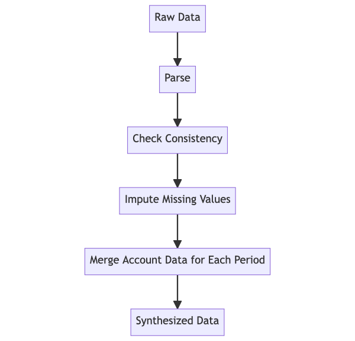
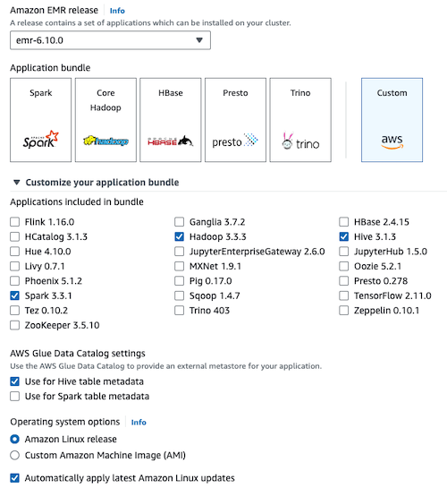

# InnerSource Synthesis <a name="pagetop"></a>

1. [Introduction](#intro)
2. [Get Started](#getstarted)
   - [BUILD](#build)
       - [Prerequisites](#buildprerequisites)
       - [Build Synthesis](#buildsynthesis)
   - [RUN](#run)
       - [Prerequisites](#runprerequisites)
       - [Use docker](#docker)
       - [Run Synthesis locally](#runsynthesis)
       - [Synthesis example run in Jupyter notebook](#jupyter)
   - [RUN ON AWS](#aws)
3. [Advanced Usage](#advanced)
4. [Migration from the Oxygen Pipeline](#migrate)
5. [Discoverability Info](#discoverability)
6. [Contribution](#contribution)
7. [License](#license)

---
---

## Introduction <a name="intro"></a>
Synthesis is the process of reading pinned records, grouping these records (by pin, account, and period as defined by the user), and generating a single record for each group-period. This resultant record comprises fields that are a reconciliation of the values within the specified group-period.

The reconciliation procedure is managed through the use of handler functions.



Click [here](example/images/SynthGraphic.gif) for an animation illustrating the synthesis process.

For a comprehensive understanding, please refer to the [Oxygen Synthesis tutorial.](https://pages.experian.com/display/ODC/Oxygen+tutorials%3A+Hands-on+Synthesis+stage)

[Return to Top](#pagetop)

---
---

## Get Started <a name="getstarted"></a>

---

### BUILD <a name="build"></a>
#### Prerequisites <a name="buildprerequisites"></a>
- [Maven](https://maven.apache.org/install.html) (brew install maven for macOS)
- [Git](https://git-scm.com/book/en/v2/Getting-Started-Installing-Git) (brew install git for macOS)
- [JDK 11](https://docs.azul.com/core/zulu-openjdk/install/macos) (install Zulu OpenJDK 11 in Self Service)
- [SSL certificates](https://pages.experian.com/display/DEVSECOPS/How+to+install+Bitbucket%27s+SSL+certificates)


#### Build Synthesis <a name="buildsynthesis"></a>
1\. Select a local working directory
> cd {/your/path}

2\. Clone the Synthesis repository
> git clone https://code.experian.local/scm/eeo/oxygen-synthesis.git
> 
> cd oxygen-synthesis

3\. Build Synthesis
> ./build_synthesis.sh
>
>or
>
> mvn -DskipTests clean package

Upon completion of the build, a JAR file is created at 
> {/your/path}/oxygen-synthesis/target/oxygen-synthesis-innersource-1.0-jar-with-dependencies.jar

[Return to Top](#pagetop)

---

### RUN <a name="run"></a>
#### Prerequisites <a name="runprerequisites"></a>
- [JDK 11](https://docs.azul.com/core/zulu-openjdk/install/macos) (install Zulu OpenJDK 11 in Self Service)
- [Scala](https://www.scala-lang.org/download/) 2.12.15
- [Spark](https://spark.apache.org/downloads.html) 3.3.1
- [Hadoop](https://hadoop.apache.org/releases.html) 3


#### Use docker <a name="docker"></a>
It is recommended to use the docker that has all the required setups. The docker container has pre-installed
- JDK 11
- Scala 2.12.15
- Spark 3.3.1
- Hadoop 3
- Python 3.11 (along with JupyterLab for analysis)

Build docker (only necessary upon initial use)

Download and load docker image “[innersource-oxygen-docker.tar](https://code.experian.local/projects/EEO/repos/innersource-oxygen-docker/raw/innersource-oxygen-docker.tar?at=refs%2Fheads%2Fmain)”

> docker load -i {path/to/}innersource-oxygen-docker.tar

Alternatively, build with Dockerfile (without VPN)

> cd {/your/path}/oxygen-synthesis
> 
> ./build_docker.sh

Run docker
> ./run_docker.sh


#### Run Synthesis locally <a name="runsynthesis"></a>
Run Synthesis with sample inputs and configurations (off VPN)
> spark-submit --master local --packages org.apache.spark:spark-avro_2.12:3.3.1 --class com.experian.edf.oxygen.consistencycheck.app.SynthesisApp target/oxygen-synthesis-innersource-1.0-jar-with-dependencies.jar env.conf consistency-application.conf oxygen-lookup.conf


Run Synthesis with defined usage of driver and executors (off VPN)
> spark-submit --master local[2] --driver-memory 2g --executor-memory 2g --packages org.apache.spark:spark-avro_2.12:3.3.1 --class com.experian.edf.oxygen.consistencycheck.app.SynthesisApp target/oxygen-synthesis-innersource-1.0-jar-with-dependencies.jar env.conf consistency-application.conf oxygen-lookup.conf

The example run uses these configuration files
> src/main/resources/env.conf
>
> src/main/resources/consistency-application.conf
>
> src/main/resources/oxygen-lookup.conf

In the configurations, we define
- Input path:
> *oxygen.stage.pinning.paths.pinnedDir = "/data/example/pinned-input"*

- Output paths:
> *oxygen.stage.consistencyCheck.paths.checkedDir = "/data/example/output-demo/checked"*
> 
> *oxygen.stage.consistencyCheck.paths.synthesizedDir = "/data/example/output-demo/synthesized"*

- Lookup path:
> *oxygen.application.paths.lookupHome = "/data/example/lookup"*

- Consistency checks dictionary file:
> *oxygen.stage.consistencyCheck.paths.dictionaryFile = ["consistency-checks.json"]*

- Domain dictionary file:
> *oxygen.stage.consistencyCheck.paths.domainDictionaryFile = ["domaindictionary.json"]*

- Custom rules file:
> *oxygen.stage.consistencyCheck.paths.customRulesFile = ["custom-rules-empty.json"]*

- Extended relationshipMigrationProcessor class:
> *oxygen.stage.consistencyCheck.relationshipMigrationProcessorClassName = "com.experian.edf.oxygen.consistencycheck.extension.migration.RelationshipMigrationProcessorImpl"

#### Synthesis example run in Jupyter notebook <a name="jupyter"></a>
A Jupyter notebook, named [*example.ipynb*](example.ipynb), can be utilized to run Synthesis locally and display the key information from input and output. This aids in acquiring a better understanding of the process.

Within the Docker, initiate JupyterLab
> cd /data
> 
> ./run_jupyterlab.sh

Access the Jupyter notebook in your browser
> https://localhost:8888/

Within JupyterLab, open the notebook
> example.ipynb

[Return to Top](#pagetop)

---

### RUN ON AWS <a name="aws"></a>
1\. Post-build, upload the JAR to S3.

- From JAR location:
> {/your/path}/oxygen-synthesis/target/oxygen-synthesis-innersource-1.0-jar-with-dependencies.jar

- To example S3 location:
> s3://oxygen-innersource/c67099a-synthesis/lib/

2\. Upload the configuration files to S3.

- From configuration files location:
> {/your/path}/oxygen-synthesis/aws/conf/*

- To example S3 location:
> s3://oxygen-innersource/c67099a-synthesis/conf/

3\. Upload input to S3.

- From input location:
> {/your/path}/oxygen-synthesis/example/pinned-input

- To example S3 location:
> s3://oxygen-innersource/c67099a-synthesis/input/

4\. Upload lookup files to S3.

- From lookup location:
> {/your/path}/oxygen-synthesis/example/lookup

- To example S3 location:
> s3://oxygen-innersource/c67099a-synthesis/

5\. Upload spark-avro jar to S3.

- From repo location:
> {/your/path}/oxygen-synthesis/aws/lib/spark-avro_2.12-3.3.1.jar

- To example S3 location:
> s3://oxygen-innersource/c67099a-synthesis/lib/

6\. Start an EMR cluster with these applications



Connect to the primary node of the EMR cluster using the given IP address, for example
> ssh -i ~/xxxxxxxx.pem hadoop@10.229.78.157

7\. Run Synthesis on AWS
> spark-submit \\  
> --master yarn \\  
> --deploy-mode cluster \\  
> --executor-cores 2 \\  
> --executor-memory 4G \\  
> --num-executors 2 \\  
> --driver-memory 4G \\  
> --conf "spark.yarn.submit.waitAppCompletion=true" \\  
> --files $(echo s3://oxygen-innersource/c67099a-synthesis/conf/\*.\* | tr ' ' ',') \\  
> --jars "s3://oxygen-innersource/c67099a-synthesis/lib/\*.jar" \\  
> --conf "spark.dynamicAllocation.enabled=false" \\  
> --conf "spark.driver.extraClassPath=/usr/lib/hadoop-lzo/lib/\*:/usr/lib/hadoop/hadoop-aws.jar:/usr/share/aws/aws-java-> sdk/\*:/usr/share/aws/emr/emrfs/conf:/usr/share/aws/emr/emrfs/lib/\*:/usr/share/aws/emr/emrfs/auxlib/\*:/usr/share/aws/emr/goodies/lib/emr-spark-goodies.jar:/usr/share/aws/emr/security/conf:/usr/share/aws/emr/security/lib/\*:/usr/share/aws/hmclient/lib/aws-glue-datacatalog-spark-client.jar:/usr/share/java/Hive-JSON-Serde/hive-openx-serde.jar:/usr/share/aws/sagemaker-spark-sdk/lib/sagemaker-spark-sdk.jar:/usr/share/aws/emr/s3select/lib/emr-s3-select-spark-connector.jar" \\  
> --conf "spark.executor.extraClassPath=/usr/lib/hadoop-lzo/lib/\*:/usr/lib/hadoop/hadoop-aws.jar:/usr/share/aws/aws-java-sdk/\*:/usr/share/aws/emr/emrfs/conf:/usr/share/aws/emr/emrfs/lib/\*:/usr/share/aws/emr/emrfs/auxlib/\*:/usr/share/aws/emr/goodies/lib/emr-spark-goodies.jar:/usr/share/aws/emr/security/conf:/usr/share/aws/emr/security/lib/\*:/usr/share/aws/hmclient/lib/aws-glue-datacatalog-spark-client.jar:/usr/share/java/Hive-JSON-Serde/hive-openx-serde.jar:/usr/share/aws/sagemaker-spark-sdk/lib/sagemaker-spark-sdk.jar:/usr/share/aws/emr/s3select/lib/emr-s3-select-spark-connector.jar" \\  
> --conf "spark.executor.extraJavaOptions=-XX:+UseG1GC" \\  
> --conf "spark.hadoop.mapreduce.fileoutputcommitter.algorithm.version=2" \\  
> --conf "spark.driver.extraJavaOptions=-Dfile.encoding=utf-8" \\  
> --conf "spark.executor.extraJavaOptions=-Dfile.encoding=utf-8" \\  
> --conf "spark.executor.extraJavaOptions=-Dlog4j.debug=true" \\  
> --conf "spark.executor.extraJavaOptions=-Dlog4j.configuration=log4j.properties" \\  
> --class com.experian.edf.oxygen.consistencycheck.app.SynthesisApp \\  
> s3://oxygen-innersource/c67099a-synthesis/lib/oxygen-synthesis-innersource-1.0-jar-with-dependencies.jar \\  
> env.conf \\  
> consistency-application.conf \\  
> oxygen-lookup.conf

8\. Inspect the output directory (as specified in the configuration) on S3
> s3://oxygen-innersource/c67099a-synthesis/output/

9\. Terminate the EMR cluster

[Return to Top](#pagetop)

---
---

## Advanced Usage <a name="advanced"></a>
Please refer to the following link for detailed information on advanced usage: [advanced.md](advanced.md).

---
---

## Migration from the Oxygen Pipeline <a name="migrate"></a>
Please refer to the following steps to transition from the Oxygen Pipeline Synthesis stage to InnerSource Synthesis: [migrate.md](migrate.md).

---
---

## Metadata <a name="discoverability"></a>
This data below is included to aid the InnerSource Discovery Hub in integrating this content into the Innersource consciousness.

```discoveryhub
app_id: OF-3819
region: Global
bu: EITS
contacts: 
  - roshan.yadav@experian.com
  - larry.yin@experian.com 

jira: https://agile.experian.com/browse/OF-3819
tags: synthesis, oxygen synthesis, consistency check, consistency, synthesize, periodic check
```

---
---

## Contribution <a name="contribution"></a>

Pull requests are welcome. For significant changes, we kindly request you to open an issue first to discuss your proposed alterations.

Please ensure to update tests as necessary.

[Oxygen Standards for Coding](https://pages.experian.com/display/ODC/Oxygen+Standards+for+Coding)

---
---

## License <a name="license"></a>

[Experian](https://www.experian.com/)

[Return to Top](#pagetop)
