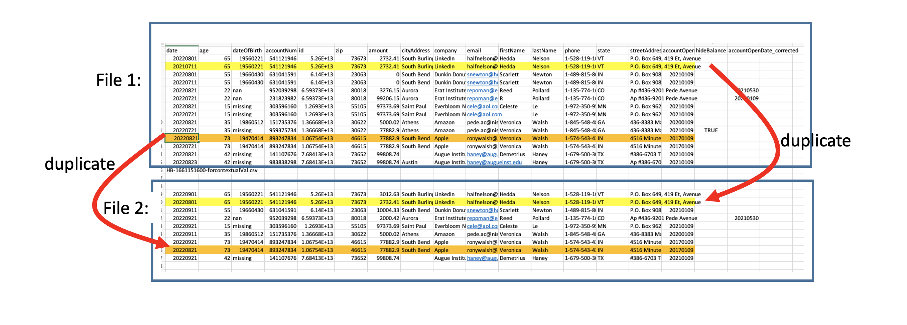
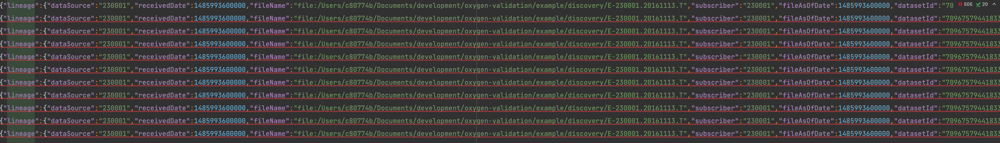

# Oxygen InnerSource Validation

1. [ Description. ](#desc)
2. [How it works.](#works)
3. [How to implement Oxygen-Validation](#imple)
4. [Get Started](#create)
   - [Build](#build)
     - [Pre-requisites](#buildprerequisites)
     - [Building Validation](#buildValidation)
   - [Before Run](#beforeRun)
     - [Configuration](#config)
   - [Running Validation](#running)
5. [Advanced Usage](#advanced)
6. [Migration from the Oxygen Pipeline](#migrate)
7. [Discoverability Info](#discoverability)
8. [Contribution](#contribution)
9. [License](#license)

---
---

<a name="desc"></a>
## Description
Validation is the first stage of an Oxygen pipeline. The Validation stage consumes files composed of transactional 
records (from a variety of external institutions such as banks, government agencies, DMV, etc.).
---
---

<a name="works"></a>
## How it works

Validation outputs files as either

validated-accepted which are forwarded onto the Acceptance stage
validated-rejected which are not propagated through the system.

Validation of input data is crucial for ensuring overall data integrity of downstream data.  
The Validation stage captures the "Experian business process" for validating batch files (in the case of 
high-throughput processing) or streamed input events (in the case of high-frequency processing). 



Here is a link where you can check the functionality of the [Validation stage.](#https://pages.experian.com/display/ODC/Oxygen+tutorials%3A++Hands-on+Validation+stage)

---
---

## Get Started <a name="getstarted"></a>

---

### BUILD <a name="build"></a>
#### Pre-requisites <a name="buildprerequisites"></a>
- [Maven](https://maven.apache.org/install.html) (brew install maven for macOS)
- [Git](https://git-scm.com/book/en/v2/Getting-Started-Installing-Git) (brew install git for macOS)
- [JDK 11](https://docs.azul.com/core/zulu-openjdk/install/macos) (install Zulu OpenJDK 11 in Self Service)
- [SSL certificates](https://pages.experian.com/display/DEVSECOPS/How+to+install+Bitbucket%27s+SSL+certificates)


#### Building Validation <a name="buildvalidation"></a>
1\. Select a local working directory
> cd {/your/development/path}

2\. Clone the Validation repository
> git clone https://code.experian.local/scm/eeo/oxygen-validation.git
>
> cd oxygen-validation

3\. Build Validation
> mvn -DskipTests clean package

Upon completion of the build, a JAR file is created at
> {/your/path}/oxygen-validation/target/oxygen-validation-innersource-1.0-jar-with-dependencies.jar

### Before run the stage <a name="beforeRun"></a>
#### Configuration <a name="config"></a>
To configure validation you can use the oxygen default config or create your own configuration.
Into this stage we have a pre-run call Discovery. This is enable by default but can be disable if it's no need it.

```dtd
oxygen {
    stage {
        validation {
            discover = true //false
        }
    }
}
```

For the pipeline the target will be the input files for Validation. As you can check in the following example,
the source is the discovery target folder and the target.
```dtd
oxygen {
 stage {
  validation {
    orchestration {
     source = ["/your/custom/workspace/discovery/output/folder"]
     target = ["/your/custom/workspace/validation/output/folder"]
    }
    paths {
     validationDir = "/your/custom/workspace/validation/input/folder"
     validatedDir = "/your/custom/workspace/validation/output/folder"
    }
  }
 }
}
```
For the validation stage we can customize the input and output path wherever the files are stored and then where will be
moved for the other stages.

We have more configuration for this stage. Here's an example how to configure custom processor for this stage.
```dtd
configs = [
    {
      fullScanSchema = false
      filePattern = ".*-.*\\..+\\.T" //This the pattern of the file names
      dupKeyCheckEnabled = true //Check duplicated keys
      processor = "com.experian.edf.oxygen.validation.extension.CreditEventValidationProcessor" //This is the custom processor that we will help us with te validation process
      searchAllHeaderFooter = true
      historicAttributeArgs = "{\"size\":1,\"status\":\"status:SUCCESS\"}"
      validate = [
        {
          filePattern = ".*A-.*\\..+\\.T" //Patern name of the file
          fileName = "(errorcodeNotIn(\"F1003\"))" //Check no code errors in the file name
          header = "((errorcodeNotIn(\"H1001\")) or count(errors) > 2)" //Check no code errors in the headers
          footer = "(errorcodeNotIn(\"F1003\"))" // Check no code error in the footer
          contexual {
            qualification = "errorcodeNotIn(\"1004\") and errorcodeIn(\"1001\") and (0.3*qs1 + 0.6*qs2) > 3 and (errorcodeIn(\"1000\")) and count(errors)>2" // Check no errors in the content
            enabled = true
            version = "v3"
          }
        }
      }
    }
]
```
You can check this file ```CreditEventValidationProcessor``` in the code and see how to implement a CustomValidationProcessor.

### Running Validation <a name="running"></a>
Run Validation with sample inputs and configurations
Run Validation with defined usage of driver and executors

> spark-submit --master local --class com.experian.edf.oxygen.validation.app.SparkValidationApp target/oxygen-validation-innersource-1.0-jar-with-dependencies.jar configs/env.conf configs/validation-application.conf

The example run uses these two configuration files
> src/main/resources/configs/env.conf
>
> sr/main/resources/configs/validation-application.conf

Input example:

Output example:s


[Contextual documentation for validation](https://pages.experian.com/pages/viewpage.action?pageId=1030473093)

---
---

## Advanced Usage <a name="advanced"></a>
Please refer to the following link for detailed information on advanced usage: [advanced.md](advanced.md).

---
---

## Migration from the Oxygen Pipeline <a name="migrate"></a>
Please refer to the following steps to transition from the Oxygen Pipeline Validation stage to InnerSource Validation: [migrate.md](migrate.md).

---
---

## Metadata <a name="discoverability"></a>
This data below is included to aid the InnerSource Discovery Hub in integrating this content into the Innersource consciousness.

```discoveryhub
app_id: OF-3819
region: Global
bu: EITS
contacts: 
  - roshan.yadav@experian.com
  - esteban.lopez@experian.com
 

jira: https://agile.experian.com/projects/INNERSOURC/summary
tags: validation, oxygen validation
```

---
---

## Contribution <a name="contribution"></a>

Pull requests are welcome. For significant changes, we kindly request you to open an issue first to discuss your proposed alterations.

Please ensure to update tests as necessary.

---
---

## License <a name="license"></a>

[Experian](https://www.experian.com/)

[Return to Top](#pagetop)
