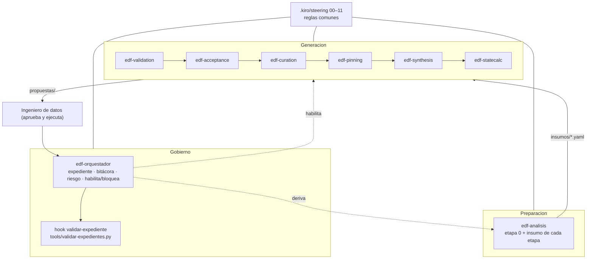
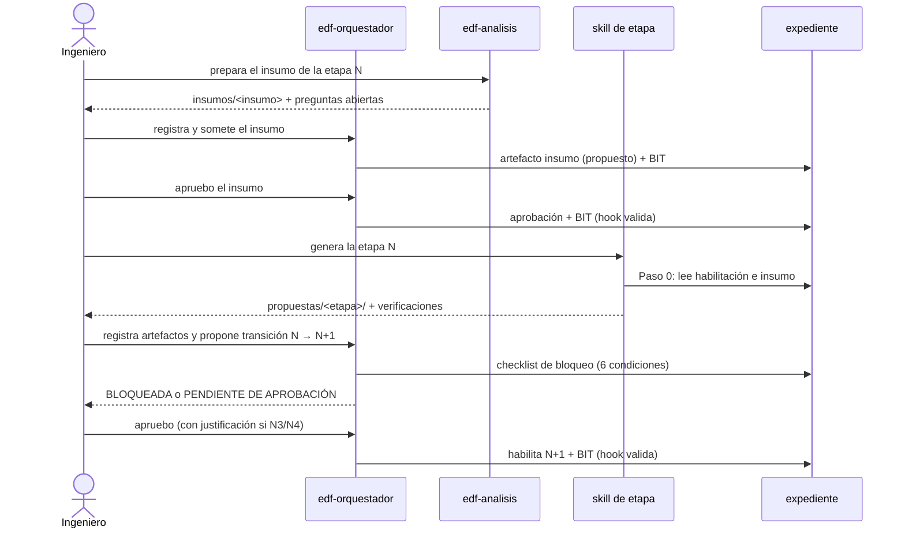

# Arquitectura del framework edf-framework-IA

| Campo | Valor |
|---|---|
| Versión | 1.0.0 |
| Fecha | 2026-11-04 |
| Estado | PROPUESTO (pasa a APROBADO con firma del aprobador del pack, `[A:OQ-06]`) |
| Opción elegida | **A — Orquestador arriba, skills de etapa abajo, bloqueo reforzado con hooks** |

Documento para personas. Kiro no lo carga; las reglas que el agente debe seguir están en `kiro/steering/`.

## 1. Qué es el framework

Un paquete de configuración de agente para Kiro IDE que guía a un ingeniero de datos de Experian a configurar una ingesta nueva en EDF/Oxygen, desde el análisis de la fuente hasta State Calculation. No compila, no se despliega y no ejecuta el pipeline: produce documentos y propuestas de código/configuración que el ingeniero revisa, aprueba y lleva al fork.

Corre en el PC de cada ingeniero, dentro de Kiro (steering `01` §0.2).

## 2. Capas

| Capa | Pieza | Responsabilidad | No hace |
|---|---|---|---|
| Reglas | `.kiro/steering/00`–`11` | Perímetro, PII, riesgo, léxico, contratos, trazabilidad. `01` es rector; `00` es el mapa | — |
| Gobierno | `edf-orquestador` | Único que escribe el expediente y la bitácora; clasifica riesgo; pide y registra aprobaciones; habilita o bloquea etapas | Generar, aprobar, ejecutar el pipeline |
| Gobierno | Hook `validar-expediente` | Tras cada escritura del agente en `expedientes/`, obliga a correr el validador (esquema + invariantes) | Decidir |
| Preparación | `edf-analisis` | Etapa 0 y el insumo de cada etapa (`source-spec-*.yaml`, `yaml-skill-*.yaml`, contrato Curation → Pinning) | Generar código, cerrar preguntas |
| Generación | 6 skills de etapa | Generan la propuesta de su etapa a partir de su insumo aprobado | Escribir el expediente, saltarse el Paso 0 |

## 3. Flujo de una etapa

## 4. Cómo se impone el bloqueo (cuatro capas)

| # | Capa | Dónde | Qué evita |
|---|---|---|---|
| 1 | Esquema JSON | `estado-ingesta.schema.json` 1.1.0 (`if/then`) | Un expediente con transición habilitada sin aprobación es JSON inválido |
| 2 | Validador + hook | `tools/validar-expediente.py`, `kiro/hooks/validar-expediente.json` | Que el agente siga después de escribir un expediente inválido |
| 3 | Orquestador | `references/03-gobierno-riesgo-aprobacion.md` §3 | Habilitar sin las 6 condiciones |
| 4 | Paso 0 de cada skill de etapa | `SKILL.md` de cada skill + steering `00` §3 | Generar una etapa no habilitada aunque el usuario lo pida directo |

Límite conocido: las capas 3 y 4 dependen de que el modelo siga las instrucciones. La capa 1–2 es mecánica. Si se necesita un bloqueo auditable que no dependa del modelo, la evolución es un servidor MCP con las operaciones críticas (registrar aprobación, habilitar), empaquetado como Power de Kiro.

## 5. Repo vs. workspace

| Repo `edf-framework-IA/` | Workspace del ingeniero (tras `instalar.ps1` / `instalar.sh`) |
|---|---|
| `kiro/steering/` | `.kiro/steering/` |
| `kiro/skills/` | `.kiro/skills/` |
| `kiro/hooks/` | `.kiro/hooks/` |
| `kiro/specs/` | `.kiro/specs/` |
| `tools/` | `tools/` |
| `docs/` | `docs/edf-framework/` |
| — | `expedientes/<ingesta-id>/` (lo crea el Orquestador por ingesta) |

`kiro/` es visible en el repo para poder navegarlo y versionarlo; Kiro solo lo lee como `.kiro/` en la raíz del workspace abierto.

## 6. Decisiones de arquitectura

| ID | Decisión | Origen |
|---|---|---|
| DA-1 | Opción A: orquestador central + skills de etapa + hooks | Usuario, 2026-11-04 |
| DA-2 | Modelo de etapas: 6 etapas + etapa 0. Reception y Preparation fuera | Usuario; decisiones H-3/H-4 |
| DA-3 | Un solo repo con instalador `ps1` y `sh` que copia todo al workspace | Usuario, 2026-11-04 |
| DA-4 | Nombres unificados `edf-<etapa>` para las 8 skills | Usuario, 2026-11-04 |
| DA-5 | `edf-analisis` produce los `source-spec-*.yaml` (uno por etapa de ingesta) y los `yaml-skill-*.yaml` en el formato actual; las skills de etapa no cambian su entrada | Usuario, 2026-11-04 |
| DA-6 | Steering global = pack de transformación (`01`–`09`) + `00` (mapa) + `10` (piloto) + `11` (contrato Curation → Pinning). El steering propio del Orquestador pasa a `references/` de su skill | Unificación, 2026-11-04 |
| DA-7 | Riesgo: taxonomía N1–N4 de `06`; el expediente usa `bajo`/`medio`/`alto`/`critico` | Unificación |
| DA-8 | State Calculation: compromiso Éxito (regla de corte posible, la aprueba el PO) y riesgo fijo N4 | Steering `02` §2 y `06` §2.2 |
| DA-9 | Las skills de etapa añaden un Paso 0 que lee el expediente; no escriben en él | Usuario autorizó el cambio, 2026-11-04 |
| DA-10 | El scoring de State Calculation (risk, trust, completeness) queda fuera del alcance (DIF-4) | Decisión del PO, comunicada por el usuario el 2026-11-04 |
| DA-11 | Reconciliación de nombres Curation → Pinning por la opción A: Curation publica también los nombres que se usan aguas abajo (`standardizedId*`) | Usuario, 2026-11-04 (detalle pendiente, steering `11` §6 #5) |
| DA-12 | Para SISBEN, `edf-pinning` no genera `IdentityMatcher`: se reutilizan la lista de atributos y el matcher compartidos de Colombia (P1) | Usuario, 2026-11-04. Clase exacta y bandera de fuente abiertas (`OQ-TR-6`, `11` §6 #7) |
| DA-13 | `standardizedIdNumber`: se eliminan los ceros a la izquierda. PPT conserva el valor original en `NUM_DOCUMENTO_SISBEN` | Usuario, 2026-11-04 (resuelve la contradicción con "completar con ceros" de `curation-pinning-sisben.md`) |
| DA-14 | DIF-1: `MANUAL_REVIEW` se implementa solo a nivel de archivo | PO, comunicado por el usuario el 2026-11-04 |

## 7. Pendientes que afectan a la arquitectura

| # | Pendiente | Efecto |
|---|---|---|
| 1 | Nombres de campo curado: decidida la opción A (DA-11). Quedan abiertos la bandera de fuente (`OQ-TR-6`), la clase del matcher, `subscriberRelation` (`OQ-IL-6`) y la concatenación de `standardizedIdName` en el generador | Pinning se detiene en el punto del matcher (`docs/estado-e2e.md`) |
| 1b | ¿SISBEN pasa por Synthesis? (`OQ-TR-4`). Si no, la omisión la firma el PO (prompt `09`) | Bloquea las etapas 5 y 6 |
| 2 | Aprobador designado del pack y del patrón `[A:OQ-06]` | Sin él, nada pasa de PROPUESTO a APROBADO y los riesgos N4 no tienen aprobador nominal |
| 3 | Diferencias con la especificación: DIF-4 cerrada (fuera de alcance), DIF-1 parcial (parámetros abiertos), DIF-2, DIF-3 y DIF-5 por confirmar con el PO (`references/04-contratos-por-skill.md`) | Alcance |
| 4 | Preguntas abiertas en el expediente vs. registro único (`09` §3) | Confirmar la separación propuesta |
| 5 | Retención de la bitácora (24 meses como supuesto) | Confirmar con política de Experian |
| 6 | Compilación de lo generado contra Oxygen no certificada (F-01) | Se reporta como evidencia, no se verifica en el framework |
| 7 | Prueba de punta a punta del piloto SISBEN con todas las skills | Pendiente |
